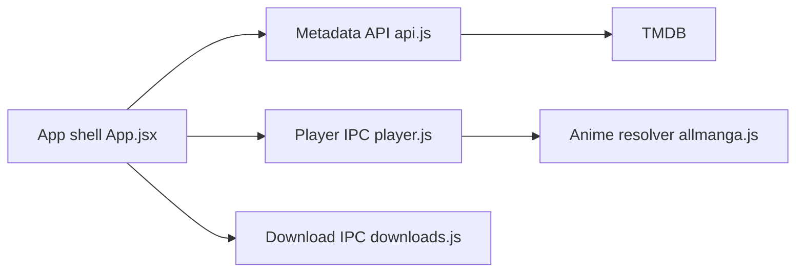

# truelockmc/streambert

> Electron app for streaming and downloading movies, series and anime from third-party sources.

## The problem
Watching and downloading video content without ads from a single application.

## What it actually does
Fetches streams via VidSrc, videasy and vidking, and metadata via TMDB (AniList for anime). Anime are scraped from AllManga. The app extracts .m3u8 playlists, downloads with ffmpeg, and handles subtitles and a viewing library.

## How it is wired


## Trying it
```bash
sudo dpkg -i streambert_*.deb
npm install
npm run dist:linux
```

## Cost and gotchas
A free TMDB token is required on first launch; ffmpeg is needed to download. The content comes from third-party sites whose rights are not guaranteed: the user is solely responsible.

## What it is not
Not a legal streaming service: the README states that it only aggregates sources. The absence of data collection does not cover the third-party sources.

## Alternatives
Cites ani-cli as the origin of the anime scraping mechanism.

## For you
Ignore: legal risk on the content, no relation to data or AI.
