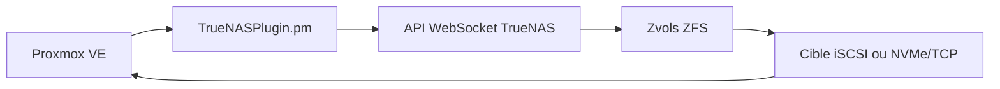

# truenas/truenas-proxmox-plugin

> Proxmox VE plugin that stores virtual machine and container disks on TrueNAS, over iSCSI or NVMe/TCP.

## The problem
Connecting TrueNAS ZFS storage to Proxmox requires manually creating volumes, extents and targets for each disk.

## What it actually does
Automatically creates zvols and iSCSI extents through the TrueNAS API, manages sessions on each node, ZFS snapshots (RAM included), grow-only resizing and clusters. NVMe/TCP is available with TrueNAS 25.10+ and Proxmox VE 9.

## How it is wired
Simplified diagram based on the sheet, no diagram provided.


## Trying it
```bash
bash <(curl -sSL https://raw.githubusercontent.com/truenas/truenas-proxmox-plugin/main/install.sh) --non-interactive --apt-install
qm create 100 --name "test-vm" --memory 2048 --cores 2
qm set 100 --scsi0 truenas-storage:32
```

## Cost and gotchas
Free, but requires TrueNAS SCALE 25.10 or later, an API key and a dataset. Known NVMe/TCP issue: I/O errors on large transfers, even silent corruption, worked around by a udev rule.

## What it is not
Not a storage for backups or ISOs. Not compatible with a TrueNAS older than 25.10. Perl for the plugin (not listed as a prerequisite).

## Alternatives
- Standard Proxmox iSCSI: without automatic volume or snapshot management.
- NFS: supports backups and ISOs, but without block-level performance.

## For you
Worth watching: useful only if you have a Proxmox homelab or cluster with TrueNAS; no direct link with your AI/MLOps work.
