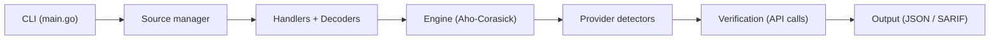

# trufflesecurity/trufflehog

> Secret scanner that detects, classifies and verifies credentials exposed in repositories, buckets and images.

## The problem
API keys and passwords slip into Git, logs or Docker images; without verification, you cannot tell which ones are still active.

## What it actually does
Multiple sources (git, GitHub, GitLab, S3, GCS, Docker, filesystem, Hugging Face, Jenkins, Elasticsearch, stdin). The engine normalizes content (archives, decoding), applies more than 800 detectors via Aho-Corasick, then tests each secret against the provider's API: verified, unverified or unknown. An `analyze` mode queries permissions. Text, JSON and SARIF outputs; GitHub action, GitLab CI and pre-commit hook.

## How it is wired


## Trying it
```bash
brew install trufflehog
trufflehog git https://github.com/trufflesecurity/test_keys --results=verified
trufflehog filesystem path/to/dir
docker run --rm -it -v "$PWD:/pwd" trufflesecurity/trufflehog:latest github --org=trufflesecurity
```

## Cost and gotchas
Free; enterprise product alongside. Verification sends real requests to providers. Without a token, GitHub repository scans are rate-limited. AGPL-3.0 license. Go APIs are not guaranteed to be stable.

## What it is not
It is not a fixer: it finds secrets but does not revoke them. A local git repository is cloned into a temporary folder for safety.

## Alternatives
- No alternative named in the README.

## For you
Adopt: put it in CI and run it on your notebook repositories and Docker images, where keys leak easily.
