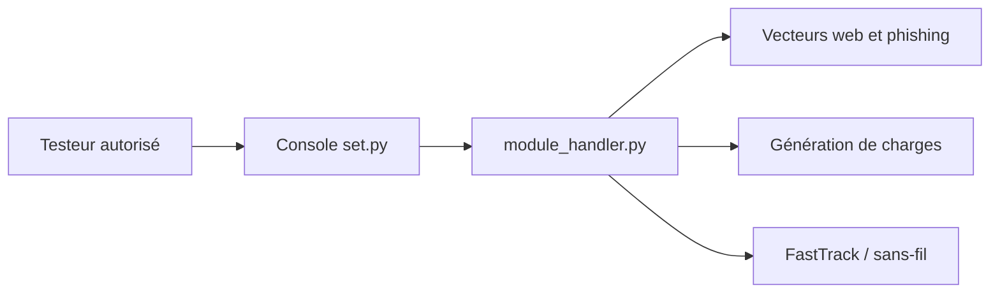

# trustedsec/social-engineer-toolkit

> TrustedSec penetration testing framework for authorized social engineering assessments, for strictly controlled defensive use.

## The problem
Security teams need to test user vigilance and validate their controls within a consented framework.

## What it actually does
An interactive Python console (`setoolkit`) with guided vectors. According to the architecture drawn from the code: web and phishing modules, payload generation, listener, network attacks (FastTrack) and wireless. The README stresses that use is restricted to authorized tests and points to a PDF user manual.

## How it is wired


## Trying it
```bash
sudo apt install set -y
sudo setoolkit
```
Another route in the README: installation from source in a virtual environment.

## Cost and gotchas
License: none is declared in the catalog, whereas the README points to `readme/LICENSE`: check before any redistribution. Root rights required. Use without explicit authorization is forbidden by the README.

## What it is not
It is not a defense or detection tool. It cannot be used without a legal framework and an agreed scope.

## Alternatives
No alternative named in the README.

## For you
Ignore: an offensive tool unrelated to a data/AI/MLOps profile, and a license status not clarified in the catalog.
