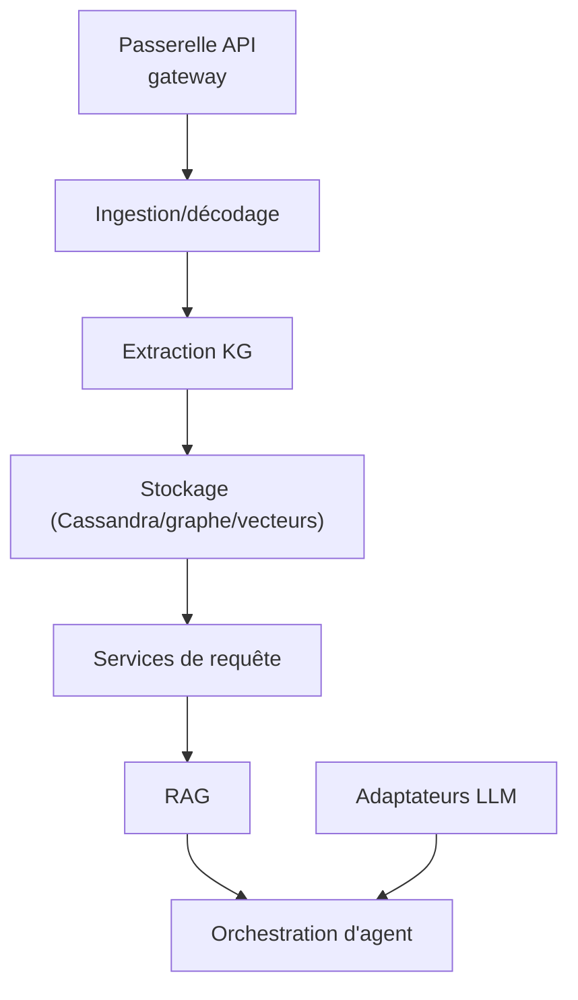

# trustgraph-ai/trustgraph

> Governance platform for AI agents that turns enterprise knowledge into a context graph and enforces action policies.

## The problem
AI agents in the enterprise lack a unified framework to understand internal data, limit their actions according to explicit rules, and prove after the fact why a decision was made.

## What it actually does
Builds an ontological knowledge graph from documents and systems, applies governance rules (authority, risk, scope) to an agent's execution, and keeps evidence and policy versions for audit. Combines three RAG techniques (document, graph, structured query) and agent orchestration (ReAct, Plan, Supervisor).

## How it is wired


## Trying it
```bash
npx @trustgraph/config
```

## Cost and gotchas
Deployed as Docker/Podman/Kubernetes containers; requires an API key for the chosen LLM provider (Anthropic, OpenAI, etc.) and possibly for third-party OCR. The rest (Cassandra, Qdrant, Pulsar/RabbitMQ) is managed internally.

## What it is not
Not a simple RAG library: it is a set of containerized services with a gateway, a message bus and several databases. It does not spare you from choosing and paying for an external LLM provider.

## Alternatives
No alternative named in the README.

## For you
Worth watching for an MLOps profile that has to govern agents in production, but the operating cost (multiple containers) should be assessed before adoption.
