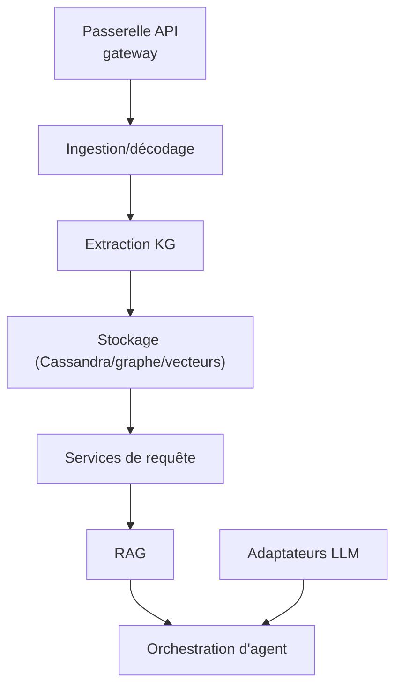

# trustgraph-ai/trustgraph

> Plateforme de gouvernance pour agents IA qui transforme connaissances d'entreprise en graphe de contexte et applique des politiques d'action.

## Le problème
Les agents IA en entreprise manquent d'un cadre unifié pour comprendre les données internes, limiter leurs actions selon des règles explicites et prouver après coup pourquoi une décision a été prise.

## Ce que ça fait vraiment
Construit un graphe de connaissances ontologique depuis documents et systèmes, applique des règles de gouvernance (autorité, risque, portée) à l'exécution d'un agent, et conserve preuves/versions de politique pour audit. Combine trois techniques RAG (document, graphe, requête structurée) et orchestration d'agents (ReAct, Plan, Supervisor).

## Comment c'est branché


## Essayer
```bash
npx @trustgraph/config
```

## Coût et pièges
Se déploie en conteneurs Docker/Podman/Kubernetes ; nécessite une clé d'API pour le fournisseur LLM choisi (Anthropic, OpenAI, etc.) et éventuellement pour l'OCR tiers. Le reste (Cassandra, Qdrant, Pulsar/RabbitMQ) est géré en interne.

## Ce que ce n'est pas
Pas une simple bibliothèque RAG : c'est un ensemble de services conteneurisés avec passerelle, bus de messages et plusieurs bases. Ne dispense pas de choisir et payer un fournisseur LLM externe.

## Alternatives
Aucune alternative nommée dans le README.

## Pour toi
À surveiller pour un profil MLOps qui doit gouverner des agents en production, mais le coût d'exploitation (conteneurs multiples) est à évaluer avant adoption.

