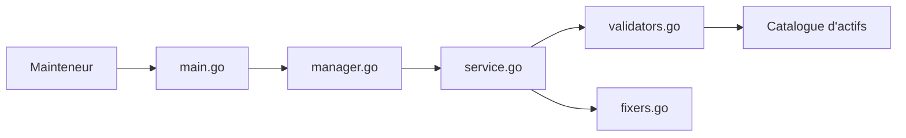

# trustwallet/assets

> Community repository of logos and information for thousands of crypto tokens, used by Trust Wallet.

## The problem
A token's data (logo, description) does not exist on-chain; every wallet would have to gather it itself.

## What it actually does
A catalogue of files per blockchain: token logos and `info.json`, staking validators, dApps, trading pair lists (`tokenlist.json`). A Go CLI validates and fixes the whole set (`make check`, `make fix`, `make update-auto`). New tokens or those with minimal circulation are rejected.

## How it is wired


## Trying it
```bash
make check
make fix
make add-token asset_id=c60_t0x4Fabb145d64652a948d72533023f6E7A623C7C53
```

## Cost and gotchas
Free. Additions go through the Assets web application (GitHub account required) and automatic checks. The team reserves the right to reject any asset deemed fraudulent.

## What it is not
Not a source of prices or market data: only logos and metadata. Being listed does not imply a partnership with Trust Wallet.

## Alternatives
No alternative named in the README.

## For you
Ignore: a crypto logo database, only useful for a wallet or on-chain analysis project.
