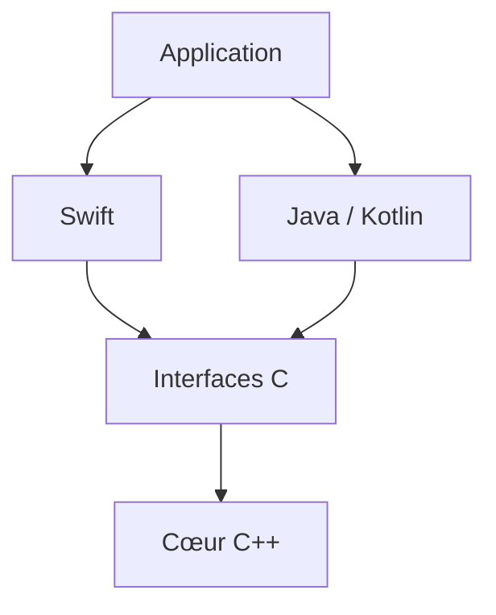

# trustwallet/wallet-core

> Mobile library of wallet cryptographic functions for many blockchains, the core of Trust Wallet.

## The problem
Every wallet must reimplement keys, addresses and signatures for each blockchain.

## What it actually does
- C++ code with strict C interfaces.
- Swift (iOS) and Java / Kotlin (Android) interfaces.
- Also available for npm, Go and Kotlin Multiplatform (in beta).
- Security audit reports provided in the audit folder.

## How it is wired
Simplified diagram based on the sheet, no diagram provided.


## Trying it
```bash
npm install @trustwallet/wallet-core
```
```ruby
pod 'TrustWalletCore'
```

## Cost and gotchas
Free. On Android, releases are on GitHub Packages: a GitHub access token is required. CocoaPods will be dropped.

## What it is not
Not a ready-to-use wallet: a low-level building block. Trust Wallet does not necessarily use all its functions.

## Alternatives
No alternative named in the README.

## For you
Ignore: useful for building a crypto wallet, unrelated to your data / AI profile.
