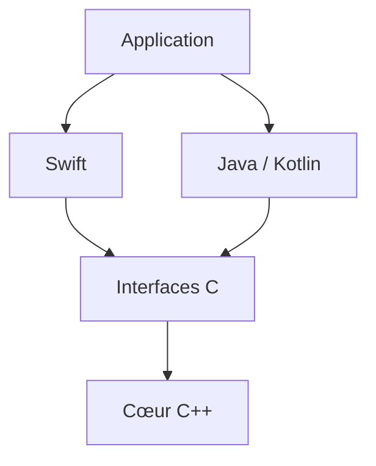

# trustwallet/wallet-core

> Bibliothèque mobile de fonctions cryptographiques de portefeuille pour de nombreuses blockchains, cœur de Trust Wallet.

## Le problème
Chaque portefeuille doit réimplémenter clés, adresses et signatures pour chaque blockchain.

## Ce que ça fait vraiment
- Code C++ avec interfaces C strictes.
- Interfaces Swift (iOS) et Java / Kotlin (Android).
- Aussi disponible pour npm, Go et Kotlin Multiplatform (en bêta).
- Rapports d'audit de sécurité fournis dans le dossier audit.

## Comment c'est branché
Schéma simplifié d'après la fiche, sans diagramme fourni.


## Essayer
```bash
npm install @trustwallet/wallet-core
```
```ruby
pod 'TrustWalletCore'
```

## Coût et pièges
Gratuit. Sur Android, les versions sont sur GitHub Packages : un jeton d'accès GitHub est nécessaire. CocoaPods sera abandonné.

## Ce que ce n'est pas
Pas un portefeuille prêt à l'emploi : une brique de bas niveau. Trust Wallet n'utilise pas forcément toutes ses fonctions.

## Alternatives
Aucune alternative nommée dans le README.

## Pour toi
À ignorer : utile pour bâtir un portefeuille crypto, sans rapport avec ton profil data / IA.

