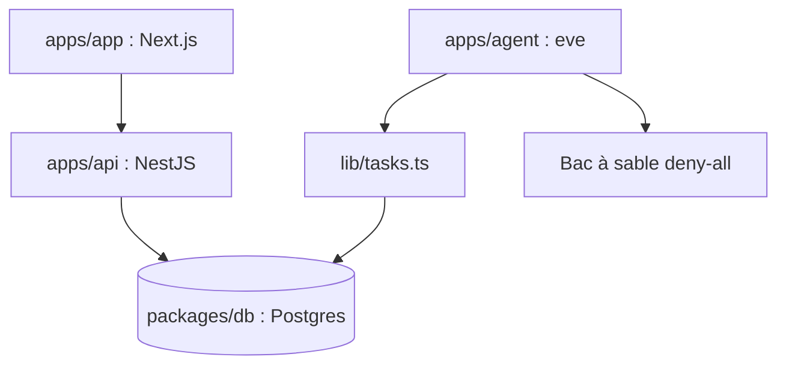

# trycompai/crm

> Open-source CRM where an autonomous research agent keeps its notes on contacts and companies.

## The problem
CRMs are databases with a form; enriching records remains manual.

## What it actually does
Three deployments: a Next.js application, a NestJS API (tRPC) and an agent built on eve (Vercel's framework for durable agents), with Postgres. The agent has 18 tools, 4 skills and a sandbox with no network or database access. It ties each fact to evidence rather than guessing. Google or Microsoft sign-in to read emails and calendar.

## How it is wired


## Trying it
```bash
git clone https://github.com/trycompai/crm.git && cd crm
cp .env.example .env
bun install
docker compose up -d
bun run db:deploy
bun run db:seed
bun run dev
```

## Cost and gotchas
Bun and Docker required; a Google or Microsoft OAuth client must be created; `BETTER_AUTH_SECRET` and `ALLOWED_SIGN_IN` must be set. Optional keys (Perplexity, Vercel's AI gateway) at your expense. Microsoft secrets expire.

## What it is not
Not a multi-organization application: single-tenant by design. It sends back telemetry, which can be disabled with `CRM_TELEMETRY_DISABLED`.

## Alternatives
No alternative cited in the README.

## For you
Ignore as a tool: a business CRM; but the "no fact without evidence" discipline is worth reading for your own agents.
