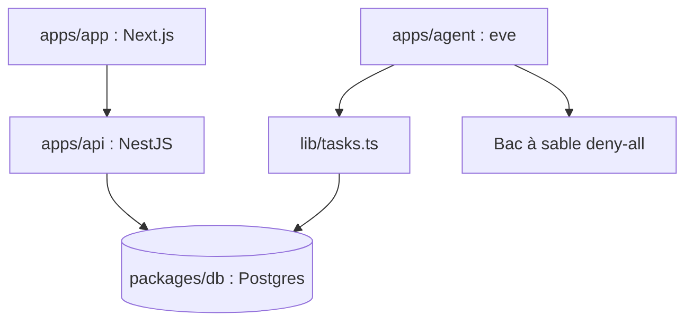

# trycompai/crm

> CRM open source où un agent de recherche autonome tient ses notes sur les contacts et entreprises.

## Le problème
Les CRM sont des bases avec un formulaire ; l'enrichissement des fiches reste manuel.

## Ce que ça fait vraiment
Trois déploiements : application Next.js, API NestJS (tRPC) et agent bâti sur eve (framework d'agents durables de Vercel), avec Postgres. L'agent dispose de 18 outils, 4 skills et d'un bac à sable sans réseau ni accès base. Il rattache chaque fait à une preuve plutôt que de deviner. Connexion Google ou Microsoft pour lire courriels et agenda.

## Comment c'est branché


## Essayer
```bash
git clone https://github.com/trycompai/crm.git && cd crm
cp .env.example .env
bun install
docker compose up -d
bun run db:deploy
bun run db:seed
bun run dev
```

## Coût et pièges
Bun et Docker requis ; client OAuth Google ou Microsoft à créer ; `BETTER_AUTH_SECRET` et `ALLOWED_SIGN_IN` à renseigner. Clés optionnelles (Perplexity, passerelle IA de Vercel) à ta charge. Les secrets Microsoft expirent.

## Ce que ce n'est pas
Pas une application multi-organisations : mono-locataire par choix. Il remonte une télémétrie, désactivable avec `CRM_TELEMETRY_DISABLED`.

## Alternatives
Aucune alternative citée dans le README.

## Pour toi
À ignorer comme outil : CRM métier ; mais la discipline « aucun fait sans preuve » mérite d'être lue pour tes propres agents.

