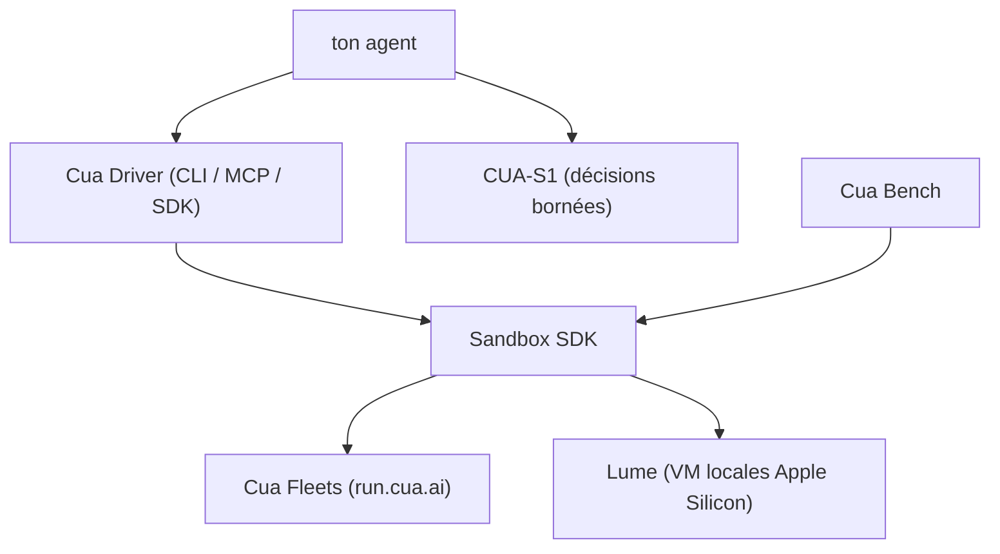

# trycua/cua

> Toolkit for having an agent drive real desktops, local or in the cloud.

## The problem
An agent that has to click in an application has no machine, no isolation, and no way to check
that the screen actually shows the expected result.

## What it actually does
Five building blocks. Cua Fleets provisions isolated Linux desktops on `run.cua.ai`, claimed from a
pool via the Sandbox SDK. Cua Driver gives the agent tools to inspect and drive native
applications and browsers on macOS, Windows and Linux, via CLI, MCP or typed SDKs.
CUA-S1 is a family of small models specialized in bounded decisions (the first profile
covers forms). Lume creates macOS and Linux VMs on Apple Silicon. Cua Bench builds
evaluation tasks and exports trajectories.

## How it is wired


## Trying it
```bash
/bin/bash -c "$(curl -fsSL https://cua.ai/driver/install.sh)"
/bin/bash -c "$(curl -fsSL https://cua.ai/lume/install.sh)"
uv tool install 'cua-bench[browser]'
uv tool run --from 'cua-bench[browser]' playwright install chromium
```

## Cost and gotchas
Fleets are paid cloud, and the README warns: a pool may keep billed capacity
after a claim ends — you must follow the cleanup steps. Lume requires Apple Silicon
hardware. Cua Bench requires Python 3.12 or 3.13 and `uv`.

## What it is not
Not an agent: "bring your own agent and model", Cua provides the machine and the tools.
CUA-S1 is not a replacement for the planning of a general-purpose agent, and its GitHub release
is a research output without weights (the weights are on Hugging Face, with their own licenses).
Local sandboxes and Fleets share neither credentials, nor images, nor runtime constraints.

## Alternatives
- Lume: the local option, if the desktops must not leave your machine.

## For you
Worth a look only if you are evaluating computer-use agents; otherwise the dependency surface is disproportionate.
