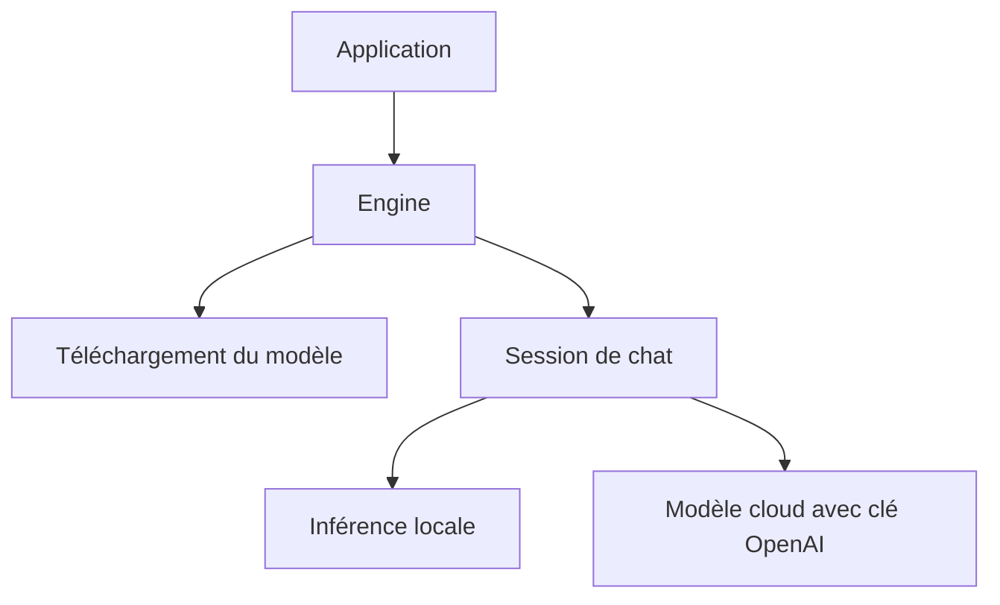

# trymirai/uzu

> Inference engine for embedding a local model in a Rust, Python, Swift or TypeScript application.

## The problem
Embedding a model in an application without going through a server means handling download, memory and an API for each language.

## What it actually does
An engine written in Rust with Rust, Python, Swift and TypeScript APIs. It downloads the model, opens a chat session, handles streaming, a model instance shared across sessions, and grammar-based structured output. It makes use of the unified memory of Apple devices. An OpenAI cloud model can also be called with your key.

## How it is wired
Simplified diagram based on the sheet, no diagram provided.


## Trying it
```bash
uv add uzu==0.6.17
pnpm add @trymirai/uzu@0.6.17
```

## Cost and gotchas
Free, MIT, no inference cost when run locally. The example model is downloaded on first launch. Cloud mode bills your OpenAI account. The README is truncated before the end: some sections are not read.

## What it is not
Not an HTTP server: an embedded library. The list of supported models is not visible here. Version 0.6.x: the API may change.

## Alternatives
No alternative named in the README.

## For you
Worth watching: relevant for embedded inference, notably on Apple, but young and not compared with established engines.
