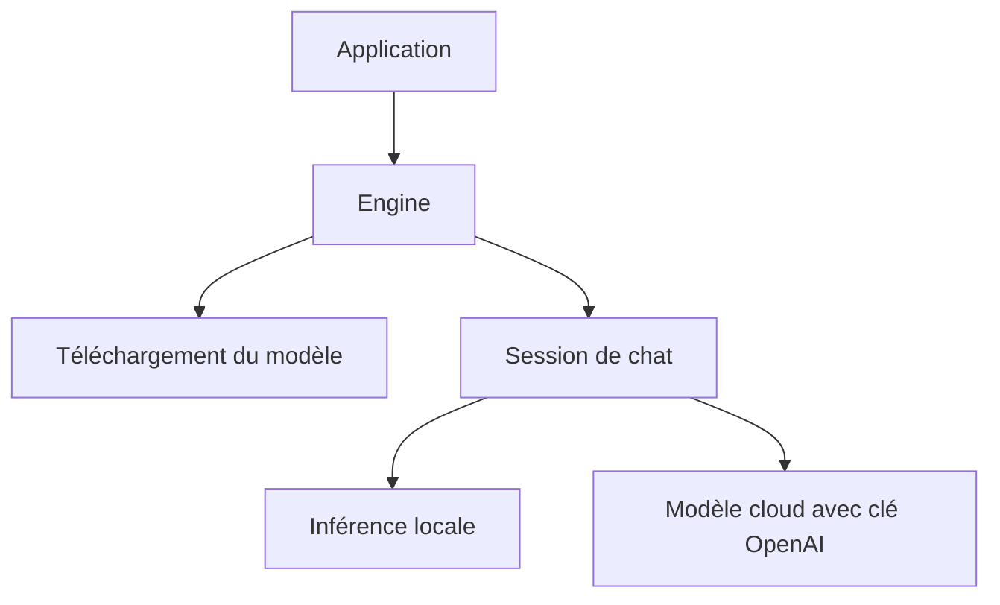

# trymirai/uzu

> Moteur d'inférence pour intégrer un modèle local dans une application Rust, Python, Swift ou TypeScript.

## Le problème
Embarquer un modèle dans une application sans passer par un serveur impose de gérer téléchargement, mémoire et API pour chaque langage.

## Ce que ça fait vraiment
Un moteur écrit en Rust avec des API Rust, Python, Swift et TypeScript. Il télécharge le modèle, ouvre une session de chat, gère le streaming, une instance de modèle partagée entre sessions et la sortie structurée par grammaire. Il exploite la mémoire unifiée des appareils Apple. Un modèle cloud OpenAI est aussi appelable avec ta clé.

## Comment c'est branché
Schéma simplifié d'après la fiche, sans diagramme fourni.


## Essayer
```bash
uv add uzu==0.6.17
pnpm add @trymirai/uzu@0.6.17
```

## Coût et pièges
Gratuit, MIT, sans coût d'inférence en local. Le modèle d'exemple est téléchargé au premier lancement. Le mode cloud facture ton compte OpenAI. Le README est tronqué avant la fin : certaines sections ne sont pas lues.

## Ce que ce n'est pas
Pas un serveur HTTP : une bibliothèque embarquée. La liste des modèles pris en charge n'est pas visible ici. Version 0.6.x : l'API peut bouger.

## Alternatives
Aucune alternative nommée dans le README.

## Pour toi
À surveiller : pertinent pour de l'inférence embarquée, notamment sur Apple, mais jeune et non comparé aux moteurs établis.

