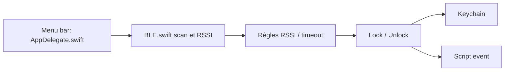

# ts1/BLEUnlock

> macOS menu-bar utility that locks and unlocks the Mac based on the proximity of a BLE device.

## The problem
Locking and unlocking the Mac by hand when you walk away or come back.

## What it actually does
Scans a Bluetooth Low Energy device (iPhone, Apple Watch or another with a fixed MAC address), tracks the RSSI, and locks or unlocks according to thresholds and delays. Stores the session password in the Keychain. Options: wake-up, playback pause, screensaver, event script. No iPhone app required.

## How it is wired


## Trying it
```
brew install bleunlock
```

## Cost and gotchas
Free (donations). You must grant Bluetooth, Accessibility and Keychain access, and store the session password: a security risk. Devices with a changing random MAC do not work.

## What it is not
Not reliable security: BLE proximity, not strong authentication. With no declared license, reuse rights are unclear.

## Alternatives
No named alternative (Apple's native Apple Watch unlock is mentioned).

## For you
Ignore: a macOS convenience tool, unlicensed and with a stored password; last push in July 2024.
