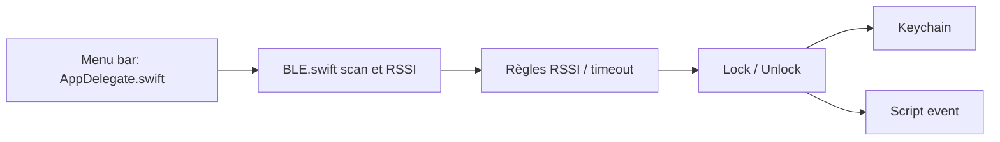

# ts1/BLEUnlock

> Utilitaire de barre de menus macOS qui verrouille et déverrouille le Mac selon la proximité d'un appareil BLE.

## Le problème
Verrouiller et déverrouiller le Mac à la main quand on s'éloigne ou revient.

## Ce que ça fait vraiment
Scanne un appareil Bluetooth Low Energy (iPhone, Apple Watch ou autre à adresse MAC fixe), suit le RSSI, verrouille ou déverrouille selon des seuils et délais. Stocke le mot de passe de session dans le Keychain. Options : réveil, pause de lecture, économiseur d'écran, script d'événement. Aucune app iPhone requise.

## Comment c'est branché


## Essayer
```
brew install bleunlock
```

## Coût et pièges
Gratuit (dons). Il faut accorder Bluetooth, Accessibilité et Keychain, et stocker le mot de passe de session : risque de sécurité. Les appareils à MAC aléatoire changeante ne marchent pas.

## Ce que ce n'est pas
Pas de la sécurité fiable : proximité BLE, pas authentification forte. Sans licence déclarée, droits de réutilisation flous.

## Alternatives
Aucune alternative nommée (le déverrouillage natif par Apple Watch est mentionné).

## Pour toi
Ignorer : outil de confort macOS, sans licence et avec mot de passe stocké ; dernier push en juillet 2024.

