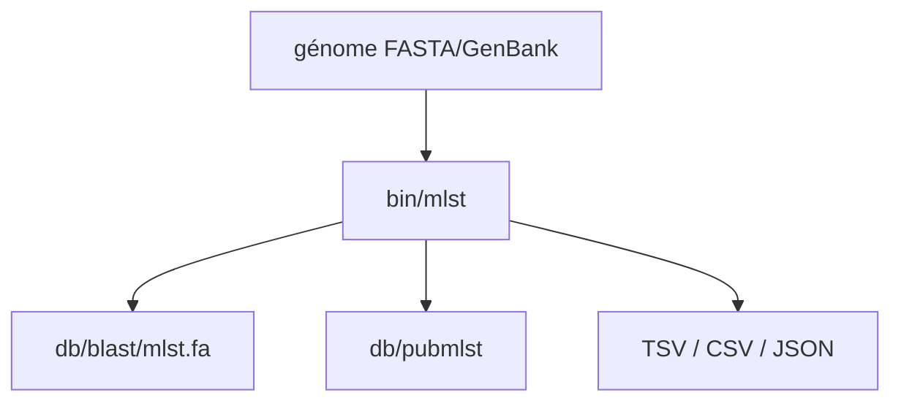

# tseemann/mlst

> Command-line tool that types bacterial genomes against the PubMLST MLST schemes.

## The problem
Determining the sequence type (ST) of a strain from contigs requires comparing alleles against many schemes.

## What it actually does
`mlst contigs.fa` detects the scheme, finds the alleles with BLAST and returns one line: file, scheme, ST, alleles. It handles compressed FASTA, GenBank, EMBL, flags new, partial or missing alleles and computes a score out of 100. Outputs TSV, CSV, JSON.

## How it is wired
Simplified diagram based on the sheet, no diagram provided.


## Trying it
```bash
conda install -c conda-forge -c bioconda mlst
mlst contigs.fa
mlst --full --fofn files.txt --csv --outfile mlst.csv
```

## Cost and gotchas
Installation via Conda (this is the documented channel, not pip). The database can no longer be updated by script: PubMLST requires an account and a key, the `mlstdb` tool is cited. License GPL-2.0.

## What it is not
Not an assembler nor an annotator: it starts from already assembled genomes.

## Alternatives
`mlstdb`, cited in the README for updating the database.

## For you
Ignore: bacterial typing bioinformatics, unless you work on genomic data.
