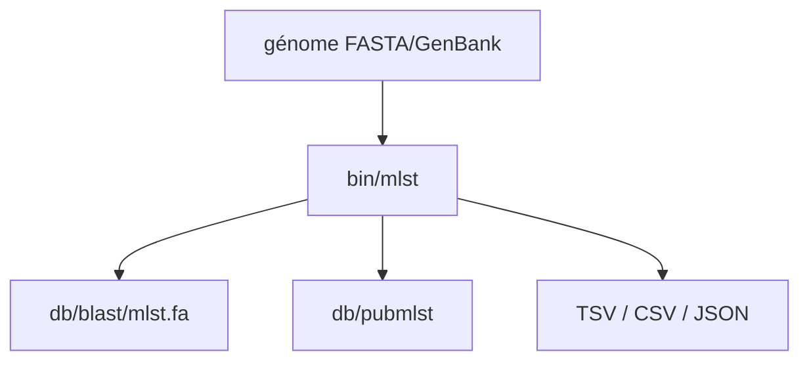

# tseemann/mlst

> Outil en ligne de commande qui type des génomes bactériens contre les schémas MLST de PubMLST.

## Le problème
Déterminer le type de séquence (ST) d'une souche à partir de contigs demande de comparer des allèles à de nombreux schémas.

## Ce que ça fait vraiment
`mlst contigs.fa` détecte le schéma, cherche les allèles par BLAST et rend une ligne : fichier, schéma, ST, allèles. Il gère FASTA, GenBank, EMBL compressés, note les allèles nouveaux, partiels ou manquants et calcule un score sur 100. Sorties TSV, CSV, JSON.

## Comment c'est branché
Schéma simplifié d'après la fiche, sans diagramme fourni.


## Essayer
```bash
conda install -c conda-forge -c bioconda mlst
mlst contigs.fa
mlst --full --fofn files.txt --csv --outfile mlst.csv
```

## Coût et pièges
Installation par Conda (c'est le canal documenté, pas pip). La base ne se met plus à jour par script : PubMLST exige un compte et une clé, l'outil `mlstdb` est cité. Licence GPL-2.0.

## Ce que ce n'est pas
Pas un assembleur ni un annotateur : il part de génomes déjà assemblés.

## Alternatives
`mlstdb`, cité dans le README pour mettre à jour la base.

## Pour toi
Ignorer : bio-informatique de typage bactérien, sauf si tu travailles sur des données génomiques.

