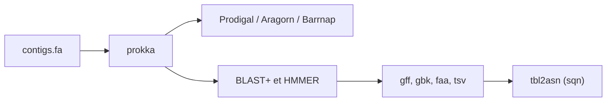

# tseemann/prokka

> Fast annotator for bacterial, archaeal and viral genomes; the author now recommends Bakta.

## The problem
A genome assembled into contigs must be annotated (genes, RNAs, products) and exported in standard formats for submission.

## What it actually does
Takes a FASTA of contigs and produces GFF3, GenBank, FASTA, a feature table and a Sequin file. Predicts CDS (Prodigal), tRNA, rRNA, then annotates through hierarchical search: BLAST+ against ISfinder, NCBI resistance databases and SwissProt, then HMMER. Options `--proteins`, `--kingdom`, `--compliant` for Genbank/ENA. Eukaryotes excluded.

## How it is wired


## Trying it
```bash
conda create -n prokka bioconda::prokka
conda activate prokka
prokka --version
prokka contigs.fa
```

## Cost and gotchas
Free; many dependencies (BioPerl, BLAST+, GNU Parallel, tbl2asn which expires). The README reports crashes related to HMMER and GNU Parallel. GPL-3.0. Last push January 2026.

## What it is not
No longer maintained by its author, who says so himself. Not for eukaryotic genomes.

## Alternatives
- Bakta: successor recommended by the author (lighter `db-light` version).
- MAKER 2 for eukaryotes (mentioned).

## For you
Ignore for a new pipeline: the maintainer himself points to Bakta; keep it only to reproduce old results.
