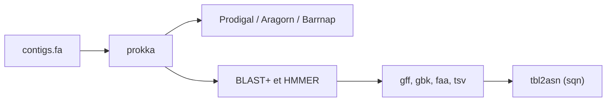

# tseemann/prokka

> Annotateur rapide de génomes de bactéries, archées et virus ; l'auteur recommande désormais Bakta.

## Le problème
Un génome assemblé en contigs doit être annoté (gènes, ARN, produits) et exporté dans des formats standards pour dépôt.

## Ce que ça fait vraiment
Prend un FASTA de contigs et produit GFF3, GenBank, FASTA, tableau de features et fichier Sequin. Prédit les CDS (Prodigal), tRNA, rRNA, puis annote par recherche hiérarchique : BLAST+ sur ISfinder, bases de résistance NCBI et SwissProt, ensuite HMMER. Options `--proteins`, `--kingdom`, `--compliant` pour Genbank/ENA. Eucaryotes exclus.

## Comment c'est branché


## Essayer
```bash
conda create -n prokka bioconda::prokka
conda activate prokka
prokka --version
prokka contigs.fa
```

## Coût et pièges
Gratuit ; nombreuses dépendances (BioPerl, BLAST+, GNU Parallel, tbl2asn qui expire). Le README signale des plantages liés à HMMER et GNU Parallel. GPL-3.0. Dernier push janvier 2026.

## Ce que ce n'est pas
Plus maintenu par l'auteur, qui l'écrit. Pas pour les génomes eucaryotes.

## Alternatives
- Bakta : successeur recommandé par l'auteur (version `db-light` allégée).
- MAKER 2 pour les eucaryotes (cité).

## Pour toi
À ignorer pour un nouveau pipeline : le mainteneur lui-même renvoie à Bakta ; ne le garde que pour reproduire d'anciens résultats.

