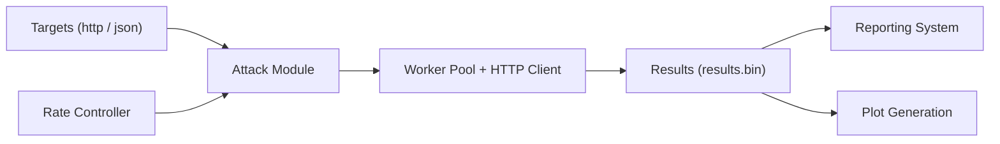

# tsenart/vegeta

> HTTP load-testing tool with a constant request rate, as a command line and a Go library.

## The problem
To measure a service's latency under load, a constant rate is needed; otherwise the server's slowness skews the measurement (coordinated omission).

## What it actually does
The `attack` command sends requests at a fixed rate (`-rate`, `-duration`) to targets read in http or JSON format, with HTTP/2, client TLS, custom DNS and a Prometheus exporter. Binary results go through `report` (text, JSON, histogram, hdrplot), `plot` (HTML) or `encode` (csv, gob, json), in Unix-style composition. Distributed mode means running the attack on several machines and merging the files.

## How it is wired


## Trying it
```bash
brew update && brew install vegeta
echo "GET http://localhost/" | vegeta attack -duration=5s | tee results.bin | vegeta report
cat results.bin | vegeta plot > plot.html
vegeta report -type=json results.bin > metrics.json
```

## Cost and gotchas
Free. File descriptor and memory limits must be adjusted (`ulimit`). With `-rate=0` and many workers, it can saturate the machine. Prometheus timestamps are those of the scrape, hence imprecise. The provided architecture diagram is missing.

## What it is not
Not a functional-testing tool nor a browser-scenario tool: it only does HTTP at a given rate. Last push on 2026-02-16.

## Alternatives
- No alternative named in the README.

## For you
Adopt: simple and scriptable to measure latency and throughput of an inference endpoint or a model API before going to production.
