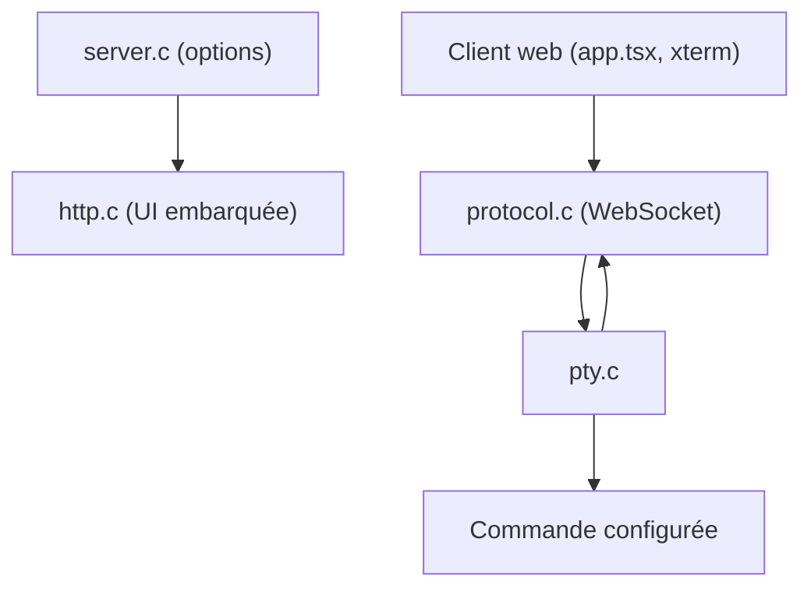

# tsl0922/ttyd

> Command-line tool that shares a terminal in the browser, for administrators and developers.

## The problem
Giving access to a remote terminal (demo, GPU machine, embedded device) without an SSH client installed.

## What it actually does
Runs a command in a pseudo-terminal and relays it over WebSocket to an xterm terminal in the browser. Handles SSL, basic authentication, client limits, ZMODEM/trzsz transfer and Sixel images. Read-only by default; `-W` allows writing.

## How it is wired


## Trying it
```bash
brew install ttyd
sudo apt install ttyd
ttyd [options] <command> [<arguments...>]
```

## Cost and gotchas
Free. Exposing a terminal on the network is risky: use `-c` (credentials), SSL, `-O` (origin check) or an authentication proxy. Last push August 2026.

## What it is not
It is not secure SSH in itself, nor a multiplexer: without settings, anyone who can reach the port gets access to the command.

## Alternatives
- Wetty: Node-based web terminal (SSH/login).
- GoTTY: web terminal written in Go.

## For you
Worth watching: handy for exposing a command-line notebook or an agent demo in a browser, provided you enable authentication and TLS.
