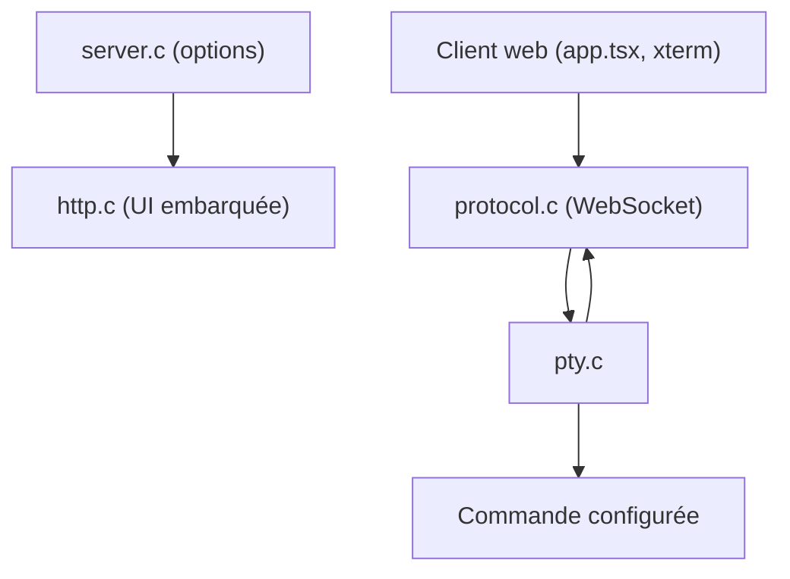

# tsl0922/ttyd

> Outil en ligne de commande qui partage un terminal dans le navigateur, pour administrateurs et développeurs.

## Le problème
Donner accès à un terminal distant (démonstration, machine GPU, appareil embarqué) sans client SSH installé.

## Ce que ça fait vraiment
Lance une commande dans un pseudo-terminal et la relaie par WebSocket vers un terminal xterm dans le navigateur. Gère SSL, authentification basique, limite de clients, transfert ZMODEM/trzsz et images Sixel. Lecture seule par défaut ; `-W` autorise l'écriture.

## Comment c'est branché


## Essayer
```bash
brew install ttyd
sudo apt install ttyd
ttyd [options] <command> [<arguments...>]
```

## Coût et pièges
Gratuit. Exposer un terminal sur le réseau est risqué : utiliser `-c` (identifiants), SSL, `-O` (vérification d'origine) ou un proxy d'authentification. Dernier push août 2026.

## Ce que ce n'est pas
Ce n'est pas un SSH sécurisé en soi ni un multiplexeur : sans réglages, n'importe qui joignant le port accède à la commande.

## Alternatives
- Wetty : terminal web basé sur Node (SSH/login).
- GoTTY : terminal web écrit en Go.

## Pour toi
À surveiller : pratique pour exposer un notebook en ligne de commande ou une démo d'agent dans un navigateur, à condition d'activer authentification et TLS.

