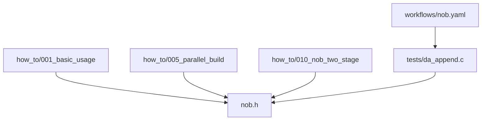

# tsoding/nob.h

> Single C header to build a C project with only a C compiler, without make or cmake.

## The problem
Building a C project requires make, cmake or a shell, which complicates portability.

## What it actually does
You copy `nob.h` into your project and write the build script in C: you compile that program, then it compiles the rest. Examples in `how_to/`: basic usage, parallel build, two-stage build. The author presents it as a research project.

## How it is wired

## Trying it
No command: copy `nob.h` into the project and read `how_to/`.

## Cost and gotchas
Free. You need to be comfortable with C, like writing shell scripts in C. The license is present but not identified by GitHub.

## What it is not
Not a cmake replacement for projects with many dependencies, according to the author. Only makes sense for C and C++.

## Alternatives
- tsoding/nobuild: previous version, discouraged by the author.
- zhiayang/nabs: same idea for C++.

## For you
Ignore: unless you write C, a build system in the language itself solves no data or MLOps problem.
