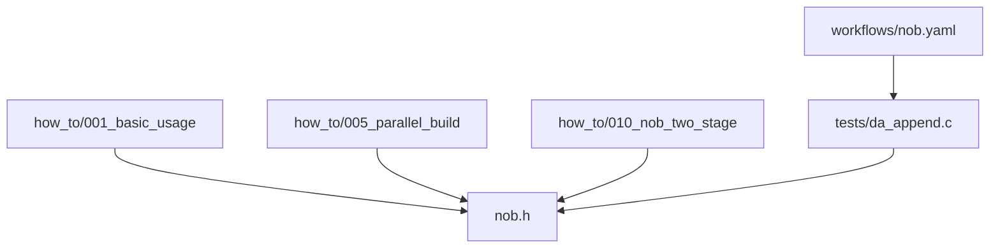

# tsoding/nob.h

> En-tête C unique pour construire un projet C avec seulement un compilateur C, sans make ni cmake.

## Le problème
Construire un projet C exige make, cmake ou un shell, ce qui complique la portabilité.

## Ce que ça fait vraiment
On copie `nob.h` dans son projet et on écrit le script de build en C : on compile ce programme, puis il compile le reste. Exemples dans `how_to/` : usage basique, build parallèle, build en deux étapes. L'auteur l'annonce comme projet de recherche.

## Comment c'est branché

## Essayer
Aucune commande : copier `nob.h` dans le projet et lire `how_to/`.

## Coût et pièges
Gratuit. Il faut être à l'aise en C, comme écrire des scripts shell en C. La licence est présente mais non identifiée par GitHub.

## Ce que ce n'est pas
Pas un remplaçant de cmake pour des projets à nombreuses dépendances, selon l'auteur. N'a de sens que pour C et C++.

## Alternatives
- tsoding/nobuild : version précédente, déconseillée par l'auteur.
- zhiayang/nabs : même idée pour C++.

## Pour toi
Ignorer : sauf si tu écris du C, un système de build dans le langage lui-même ne résout aucun problème data ou MLOps.

