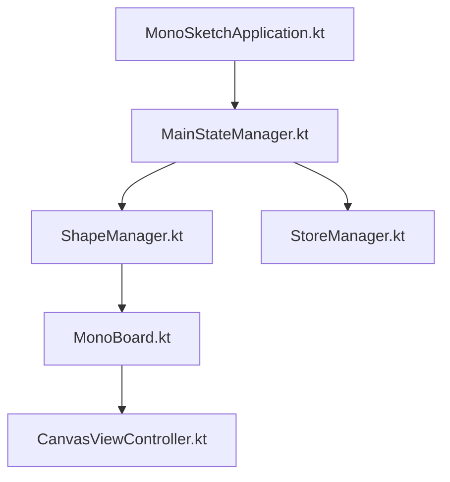

# tuanchauict/MonoSketch

> Web editor for ASCII-character diagrams, running entirely in the browser, for documentation.

## The problem
Drawing a readable diagram in a README or a code comment without going through an image.

## What it actually does
It offers rectangle, text, line and freehand brush, with fill, borders, arrows and rounded corners. The canvas is infinite, with autosave, multiple projects, groups, layers and dark mode. It exports the text via a shortcut and shares through GitHub Gist. Everything stays client-side.

## How it is wired


## Trying it
```bash
./gradlew jsBrowserDevelopmentRun --continuous -Dorg.gradle.parallel=false
```
Online version: app.monosketch.io.

## Cost and gotchas
Free. To build: Java (Gradle, Kotlin/JS), Node downloaded by Gradle. The project is being rewritten in TypeScript (`port-to-js` branch).

## What it is not
It is not a structured diagram tool like UML or Mermaid: it is character-based drawing.

## Alternatives
No alternative named in the README.

## For you
Worth watching: handy for documenting a pipeline in text, but the ongoing rewrite makes the Kotlin codebase uncertain.
