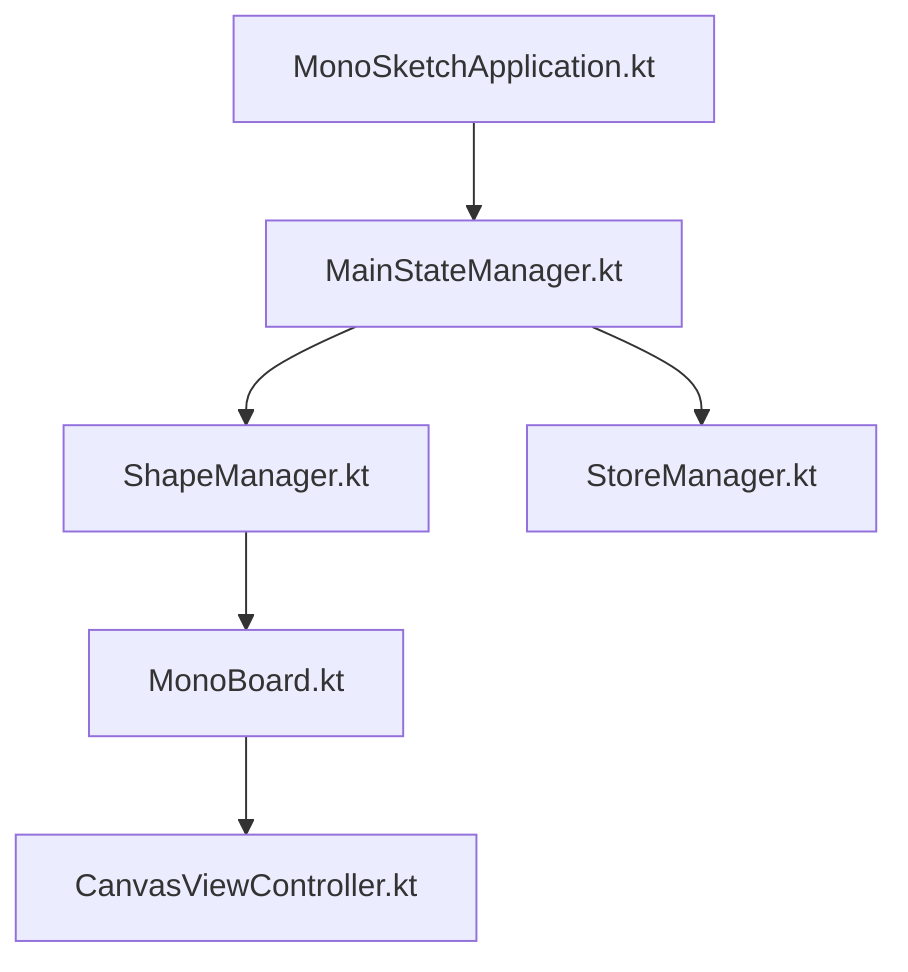

# tuanchauict/MonoSketch

> Éditeur web de diagrammes en caractères ASCII, tournant entièrement dans le navigateur, pour documenter.

## Le problème
Dessiner un schéma lisible dans un README ou un commentaire de code sans passer par une image.

## Ce que ça fait vraiment
Il propose rectangle, texte, ligne et pinceau libre, avec remplissage, bordures, flèches et coins arrondis. Le canevas est infini, avec sauvegarde automatique, projets multiples, groupes, calques et mode sombre. Il exporte le texte par raccourci et partage via GitHub Gist. Tout reste côté client.

## Comment c'est branché


## Essayer
```bash
./gradlew jsBrowserDevelopmentRun --continuous -Dorg.gradle.parallel=false
```
Version en ligne : app.monosketch.io.

## Coût et pièges
Gratuit. Pour compiler : Java (Gradle, Kotlin/JS), Node téléchargé par Gradle. Le projet est en cours de réécriture en TypeScript (branche `port-to-js`).

## Ce que ce n'est pas
Ce n'est pas un outil de diagrammes structurés type UML ou Mermaid : c'est du dessin en caractères.

## Alternatives
Aucune alternative nommée dans le README.

## Pour toi
À surveiller : pratique pour documenter un pipeline en texte, mais la réécriture en cours rend la base Kotlin incertaine.

