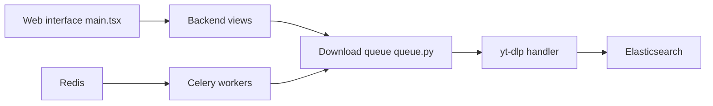

# tubearchivist/tubearchivist

> Self-hosted YouTube archive: subscriptions, yt-dlp download, indexing and offline playback.

## The problem
A collection of YouTube videos becomes impossible to search; videos can disappear.

## What it actually does
Subscribes to channels, downloads with yt-dlp, indexes metadata and comments in Elasticsearch, and serves a web interface for search and playback. Redis and Celery handle scheduled tasks. It tracks watched and unwatched videos.

## How it is wired


## Trying it
```bash
sudo sysctl -w vm.max_map_count=262144
```
Then start from the repository's example `docker-compose.yml`, and set `TA_HOST`, `TA_USERNAME`, `TA_PASSWORD`, `ELASTIC_PASSWORD`, `REDIS_CON`, `TZ`.

## Cost and gotchas
2 to 4 GB of RAM, Docker, Elasticsearch and Redis required; disk usage must stay below 95%. Updates can break things (read the release notes).

## What it is not
Not a lightweight client: it depends on yt-dlp and inherits its limits. File naming is not configurable.

## Alternatives
No alternative named in the README (Jellyfin/Plex plugins are cited as complements).

## For you
Worth watching: useful for archiving educational content or talks, but with no direct link to data/AI work and expensive in resources.
