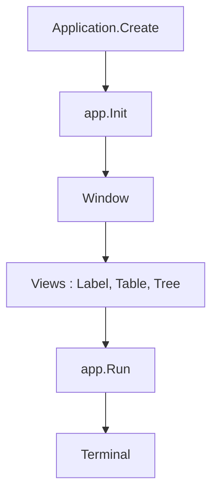

# tui-cs/Terminal.Gui

> .NET library for building cross-platform text interfaces, aimed at C# developers who ship terminal tools.

## The problem
Writing a terminal interface by hand means handling the screen, keyboard, mouse and layout with no ready-made components.

## What it actually does
It provides a layout system, double-buffered rendering and widgets: text editor, tables, trees, menus, wizards, file pickers. Keyboard comes first, mouse is handled too. Applications run full screen or inline, with configurable themes and shortcuts.

## How it is wired
Simplified diagram based on the sheet, no diagram provided.



## Trying it
```bash
dotnet new install Terminal.Gui.Templates
dotnet new tui-simple -n myproj
cd myproj
dotnet run
dotnet run --project Examples/UICatalog/UICatalog.csproj
```

## Cost and gotchas
Free, MIT license. Requires the .NET SDK, which is absent from the standard prerequisites list, so not checked here. Version 2 changes the architecture: the README points to a migration guide from version 1.

## What it is not
Not a library for Python or Node: it is specific to .NET. Nor is it a data science tool, only a way to dress up a terminal program.

## Alternatives
- ArthurSonzogni/FTXUI: same idea in C++, with no dependencies.

## For you
Watch: useful only if you write internal tools in C#, otherwise little direct link with a data / AI / MLOps profile.
