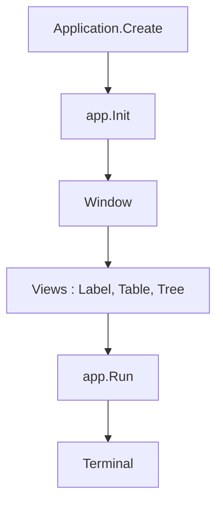

# tui-cs/Terminal.Gui

> Bibliothèque .NET pour construire des interfaces texte multiplateformes, destinée aux développeurs C# qui livrent des outils en terminal.

## Le problème
Écrire une interface en terminal à la main oblige à gérer l'écran, le clavier, la souris et la mise en page sans aucun composant prêt à l'emploi.

## Ce que ça fait vraiment
Elle fournit un système de mise en page, un rendu à double tampon et des widgets : éditeur de texte, tables, arbres, menus, assistants, sélecteurs de fichiers. Le clavier est prioritaire, la souris est gérée aussi. Les applications tournent en plein écran ou en ligne, avec thèmes et raccourcis configurables.

## Comment c'est branché
Schéma simplifié d'après la fiche, sans diagramme fourni.



## Essayer
```bash
dotnet new install Terminal.Gui.Templates
dotnet new tui-simple -n myproj
cd myproj
dotnet run
dotnet run --project Examples/UICatalog/UICatalog.csproj
```

## Coût et pièges
Gratuit, sous licence MIT. Il faut le SDK .NET, absent de la liste des prérequis standard, donc non coché ici. La version 2 change l'architecture : le README renvoie à un guide de migration depuis la version 1.

## Ce que ce n'est pas
Ce n'est pas une bibliothèque pour Python ou Node : elle est propre à .NET. Ce n'est pas non plus un outil de data science, seulement un moyen d'habiller un programme en terminal.

## Alternatives
- ArthurSonzogni/FTXUI : même idée en C++, sans dépendances.

## Pour toi
Surveiller : utile seulement si tu écris des outils internes en C#, sinon peu de lien direct avec un profil data / IA / MLOps.

