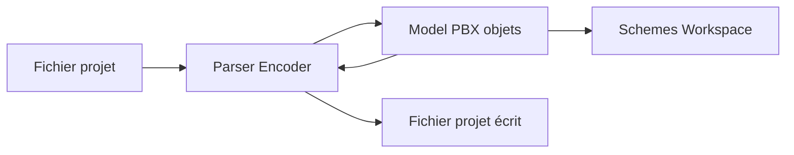

# tuist/XcodeProj

> Swift library to read, modify and write Xcode project files.

## The problem
Editing a `project.pbxproj` by hand or by script is fragile.

## What it actually does
Loads an `.xcodeproj` as an object graph (`PBXProj`), lets you modify it, then writes it back. It also supports, experimentally, the `project.xcproj` JSON format introduced by Xcode 27.2, with conversion via an argument. Handles schemes, workspaces and Swift package references.

## How it is wired


## Trying it
```bash
scripts/set-project-version ./App.xcodeproj 1.2.3
```
SwiftPM dependency: `.package(url: "https://github.com/tuist/XcodeProj.git", .upToNextMajor(from: "8.12.0"))`.

## Cost and gotchas
Free. JSON format support is experimental: check before committing.

## What it is not
Not a command-line tool: it is a library for scripts and tools. It does not compile anything.

## Alternatives
The README cites ProjLint, Tuist, XcodeGen and Sourcery as projects that use it.

## For you
Ignore: iOS tooling unrelated to data or MLOps.
