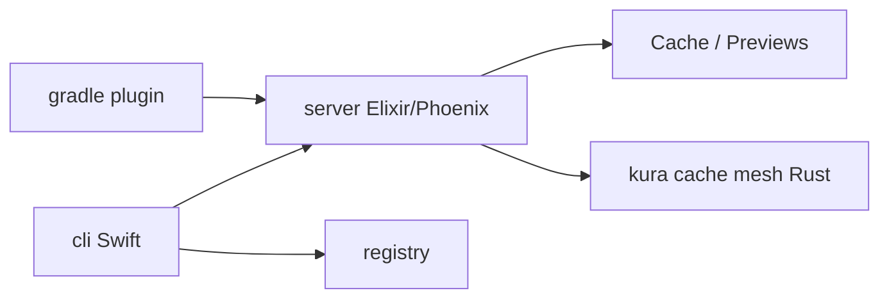

# tuist/tuist

> Build acceleration platform for Xcode, Gradle and Bazel: cache, targeted tests, registry, insights.

## The problem
Builds and tests of mobile apps are slow and opaque at scale.

## What it actually does
Content-addressed build cache, selective tests based on modified files, a registry for the Swift Package Index, build and bundle analytics, preview sharing, generated Xcode projects. Monorepo: Swift CLI, app, Gradle plugin, Elixir/Phoenix server, Rust cache service (kura).

## How it is wired

## Trying it
No command in the README; installation is described in the Tuist documentation.

## Cost and gotchas
Server features assume the hosted service; an account must be created. License not identified by GitHub.

## What it is not
Not a compiler nor a CI: it is a layer around your existing build.

## Alternatives
No alternative named.

## For you
Ignore: useful only to iOS/Android app teams.
