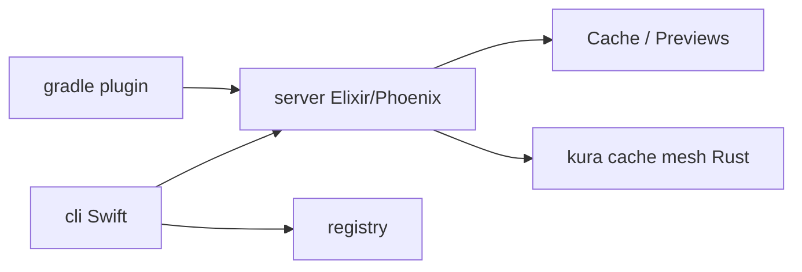

# tuist/tuist

> Plateforme d'accélération de builds Xcode, Gradle et Bazel : cache, tests ciblés, registre, insights.

## Le problème
Les builds et tests d'apps mobiles sont lents et opaques à grande échelle.

## Ce que ça fait vraiment
Cache de build à adressage par contenu, tests sélectifs selon les fichiers modifiés, registre pour Swift Package Index, analyses de builds et de bundles, partage de previews, projets Xcode générés. Monorepo : CLI Swift, app, plugin Gradle, serveur Elixir/Phoenix, service de cache Rust (kura).

## Comment c'est branché

## Essayer
Aucune commande dans le README ; installation décrite dans la documentation Tuist.

## Coût et pièges
Les fonctions serveur supposent le service hébergé ; compte à créer. Licence non identifiée par GitHub.

## Ce que ce n'est pas
Pas un compilateur ni un CI : c'est une couche autour de ton build existant.

## Alternatives
Aucune alternative nommée.

## Pour toi
Ignorer : utile aux équipes d'apps iOS/Android uniquement.

