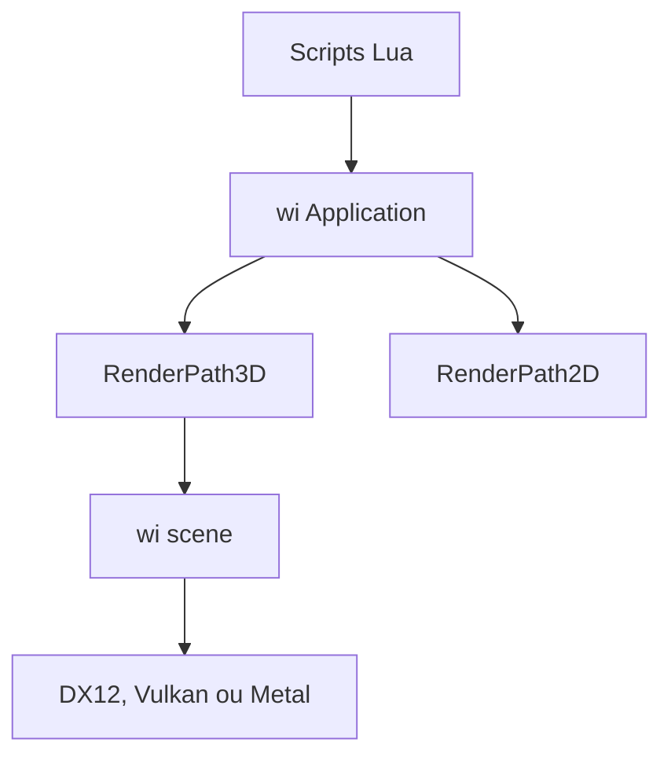

# turanszkij/WickedEngine

> C++ 3D engine with modern rendering, an editor and Lua scripting, for graphics projects.

## The problem
You need a modern, open, embeddable 3D engine, without going through a big commercial engine.

## What it actually does
C++ library with 2D and 3D render paths, scene, entity-component system, audio, input, a standalone editor and a Lua API. Imports OBJ, FBX, GLTF, VRM, PLY; native WISCENE format. Rendering with DirectX 12 on Windows, Vulkan on Linux, Metal on Apple.

## How it is wired

No diagram provided: simplified diagram based on the README.

## Trying it
```bash
sudo apt update
sudo apt install libsdl2-dev
sudo apt install build-essential
mkdir build
cd build
cmake .. -DCMAKE_BUILD_TYPE=Release
make
```

## Cost and gotchas
Free. A compatible GPU is required. Console extensions (Xbox, PlayStation 5) are private.

## What it is not
Not an AI or data tool. Not a turnkey complete game engine: it is a graphics framework.

## Alternatives
No alternative named in the README.

## For you
Ignore for your profile: a rendering engine unrelated to data or MLOps, unless you need 3D visualization.
