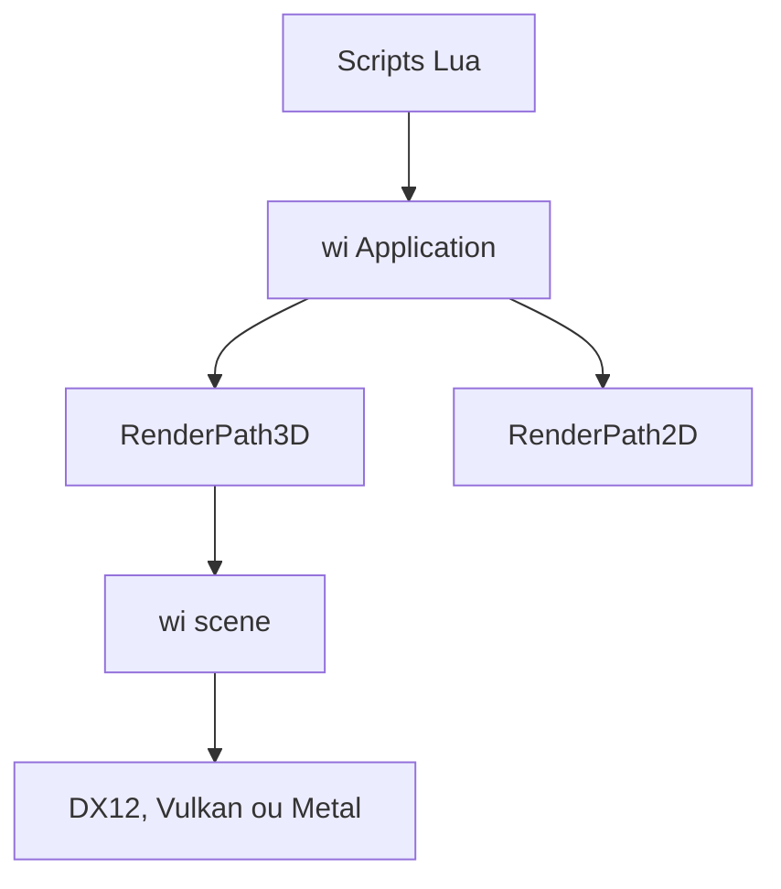

# turanszkij/WickedEngine

> Moteur 3D C++ au rendu moderne, avec éditeur et scripts Lua, pour projets graphiques.

## Le problème
Il faut un moteur 3D moderne, ouvert et embarquable, sans passer par un gros moteur commercial.

## Ce que ça fait vraiment
Bibliothèque C++ avec chemins de rendu 2D et 3D, scène, entités-composants, audio, entrées, éditeur autonome et API Lua. Import OBJ, FBX, GLTF, VRM, PLY ; format natif WISCENE. Rendu DirectX 12 sous Windows, Vulkan sous Linux, Metal sous Apple.

## Comment c'est branché

Schéma non fourni : diagramme simplifié d'après le README.

## Essayer
```bash
sudo apt update
sudo apt install libsdl2-dev
sudo apt install build-essential
mkdir build
cd build
cmake .. -DCMAKE_BUILD_TYPE=Release
make
```

## Coût et pièges
Gratuit. GPU compatible nécessaire. Extensions consoles (Xbox, PlayStation 5) privées.

## Ce que ce n'est pas
Pas un outil d'IA ni de data. Pas un moteur de jeu complet clé en main : c'est un framework graphique.

## Alternatives
Aucune alternative nommée dans le README.

## Pour toi
À ignorer pour ton profil : moteur de rendu sans rapport avec data ou MLOps, sauf besoin de visualisation 3D.

