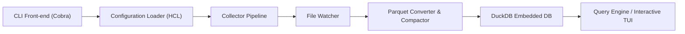

# turbot/tailpipe

> CLI that collects cloud logs into Parquet and queries them in SQL with DuckDB, locally.

## The problem
Querying cloud logs (CloudTrail…) requires a remote warehouse or ad hoc scripts.

## What it actually does
`tailpipe collect` downloads and enriches the logs of a source (AWS, Azure, GCP plugin) and writes them as Parquet; `tailpipe query` opens an interactive SQL mode on DuckDB. Configuration is done in HCL (connections, partitions, sources). Ready-made benchmarks and detections (MITRE ATT&CK) exist via Powerpipe.

## How it is wired


## Trying it
```bash
brew install turbot/tap/tailpipe
tailpipe plugin install aws
tailpipe collect aws_cloudtrail_log
tailpipe query
```

## Cost and gotchas
Cloud credentials for each source; plugins are downloaded from an OCI registry. AGPL-3.0 licence. The version shown in the README is 0.1.0; 39 open issues.

## What it is not
Not a SIEM nor a hosted service: everything runs on your machine. Detections go through a separate tool, Powerpipe.

## Alternatives
No alternative cited; Powerpipe is a complement, not a substitute.

## For you
Worth watching: local SQL on logs, useful for analysis and security; the AGPL licence must be checked before any use in a product.
