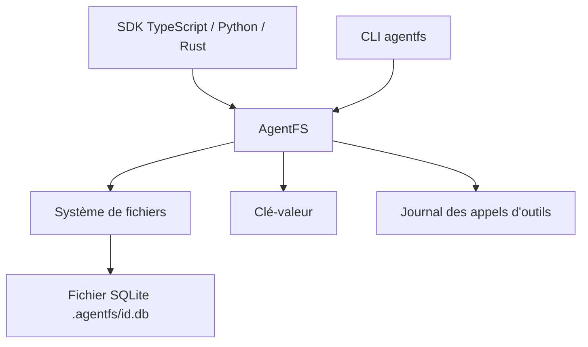

# tursodatabase/agentfs

> SQLite-based filesystem for AI agents, which keeps files, state and tool calls.

## The problem
An agent writes files and state with no queryable trace, which makes it hard to audit, replay or move.

## What it actually does
Stores everything in a SQLite file (via Turso): a POSIX filesystem, a key-value store and a log of tool calls. Provides TypeScript, Python and Rust SDKs, a CLI (`agentfs init`, `fs`, `timeline`, `mount`, `run`) and a specification. Mounting uses FUSE on Linux and NFS on macOS. Copying the file is enough to take a snapshot.

## How it is wired
Simplified diagram based on the sheet, no diagram provided.


## Trying it
```bash
curl -fsSL https://agentfs.ai/install | bash
agentfs init my-agent
agentfs fs my-agent ls
agentfs timeline my-agent
agentfs mount my-agent ./mnt
npm install agentfs-sdk
```

## Cost and gotchas
Free. The README warns that the software is in beta: back up your data. Installation goes through a `curl | bash` script. The `agentfs run` sandbox is described as experimental.

## What it is not
Not a complete security sandbox: the README presents it as complementary to Docker Sandbox. Not a Git replacement: it works beneath Git and also covers untracked files. No license is declared in the catalog.

## Alternatives
- Bubblewrap: isolation through Linux namespaces, with no queryable persistence.
- Docker Sandbox: execution isolation, to be combined with AgentFS.
- Git worktrees: separate working copies, but isolation is only conventional.

## For you
Worth watching: SQL audit and state snapshots are of interest for agent MLOps, but the project is in beta and has no declared license.
