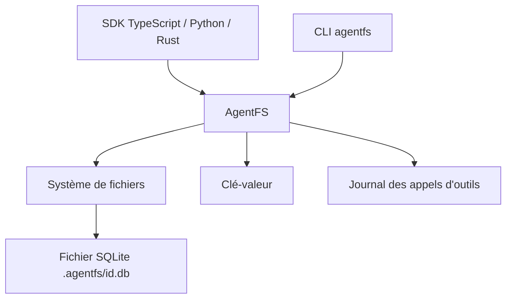

# tursodatabase/agentfs

> Système de fichiers sur SQLite pour agents IA, qui garde fichiers, état et appels d'outils.

## Le problème
Un agent écrit des fichiers et de l'état sans trace interrogeable, difficile à auditer, à rejouer ou à déplacer.

## Ce que ça fait vraiment
Stocke tout dans un fichier SQLite (via Turso) : système de fichiers POSIX, magasin clé-valeur et journal des appels d'outils. Fournit des SDK TypeScript, Python et Rust, une CLI (`agentfs init`, `fs`, `timeline`, `mount`, `run`) et une spécification. Le montage utilise FUSE sous Linux et NFS sous macOS. Une copie du fichier suffit à prendre un instantané.

## Comment c'est branché
Schéma simplifié d'après la fiche, sans diagramme fourni.


## Essayer
```bash
curl -fsSL https://agentfs.ai/install | bash
agentfs init my-agent
agentfs fs my-agent ls
agentfs timeline my-agent
agentfs mount my-agent ./mnt
npm install agentfs-sdk
```

## Coût et pièges
Gratuit. Le README avertit que le logiciel est en bêta : sauvegarder les données. L'installation passe par un script `curl | bash`. Le bac à sable `agentfs run` est qualifié d'expérimental.

## Ce que ce n'est pas
Pas un bac à sable de sécurité complet : le README le donne comme complémentaire de Docker Sandbox. Pas un remplaçant de Git : il travaille sous Git et couvre aussi les fichiers non suivis. Aucune licence n'est déclarée au catalogue.

## Alternatives
- Bubblewrap : isolation par espaces de noms Linux, sans persistance interrogeable.
- Docker Sandbox : isolation d'exécution, à combiner avec AgentFS.
- Git worktrees : copies de travail séparées, mais isolation seulement conventionnelle.

## Pour toi
À surveiller : l'audit SQL et les instantanés d'état intéressent le MLOps d'agents, mais le projet est en bêta et sans licence déclarée.

