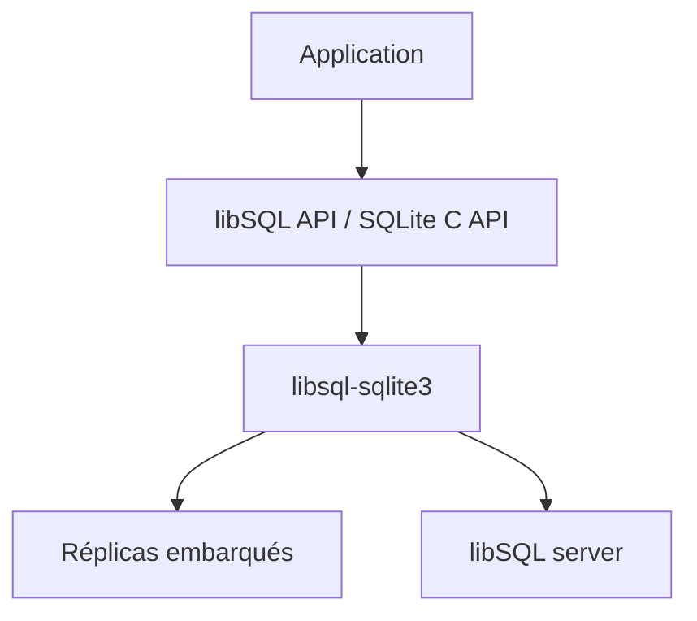

# tursodatabase/libsql

> Open source fork of SQLite with embedded replicas and remote access, maintained by the Turso team.

## The problem
SQLite does not accept outside contributions and offers neither remote access nor native replication.

## What it actually does
SQLite fork compatible with the file format and the C API. Adds embedded replicas, a server for remote access, extended `ALTER TABLE`, random ROWID, WebAssembly user-defined functions and a virtual WAL interface. Official drivers: TypeScript/JS, Rust, Go; Python and C are experimental.

## How it is wired


## Trying it
```bash
cargo xtask build
cd libsql-sqlite3 && ./libsql
```

## Cost and gotchas
Free. Building is up to you. The README warns that new features are arriving in Turso database, a Rust rewrite, in beta.

## What it is not
Not the Turso database: they are separate projects. Inherits SQLite's limits, including the single-writer model.

## Alternatives
- Turso database: Rust rewrite of SQLite, concurrent writes and offline sync; recommended for a new project.

## For you
Worth watching: interesting for embedded data or local replicas, but development is happening elsewhere, at Turso.
