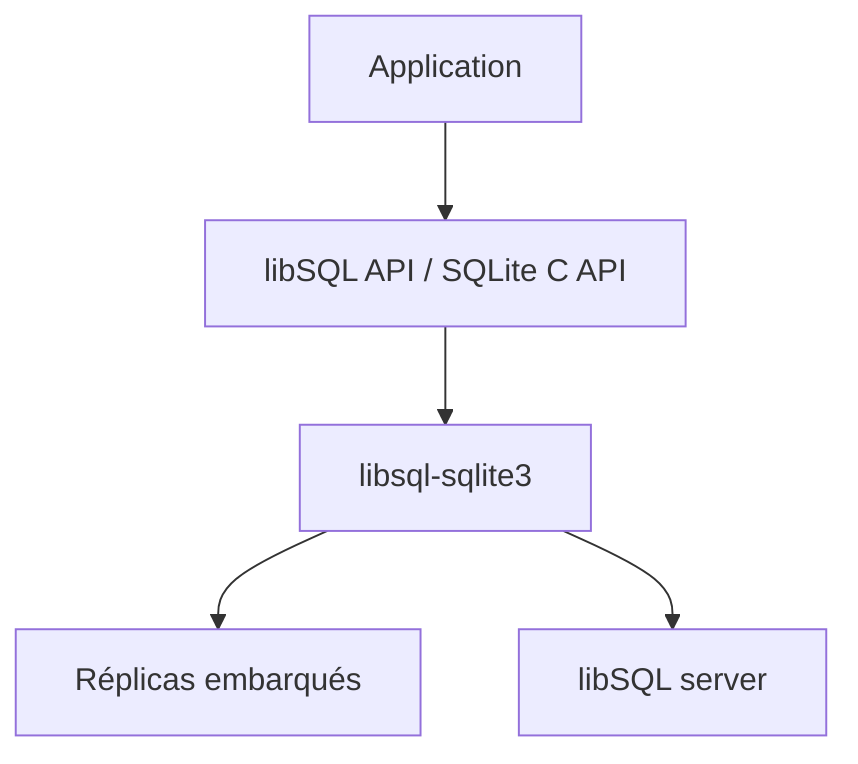

# tursodatabase/libsql

> Fork open source de SQLite avec réplicas embarqués et accès distant, maintenu par l'équipe Turso.

## Le problème
SQLite n'accepte pas de contributions externes et ne propose pas d'accès distant ni de réplication native.

## Ce que ça fait vraiment
Fork de SQLite compatible avec le format de fichier et l'API C. Ajoute des réplicas embarqués, un serveur pour l'accès distant, `ALTER TABLE` étendu, ROWID aléatoire, fonctions utilisateur WebAssembly et une interface de journal WAL virtuel. Pilotes officiels : TypeScript/JS, Rust, Go ; Python et C expérimentaux.

## Comment c'est branché


## Essayer
```bash
cargo xtask build
cd libsql-sqlite3 && ./libsql
```

## Coût et pièges
Gratuit. Compilation à ta charge. Le README prévient que les nouvelles fonctions arrivent dans Turso database, une réécriture en Rust, en bêta.

## Ce que ce n'est pas
Pas la base Turso : projets distincts. Hérite des limites de SQLite, dont le modèle à un seul écrivain.

## Alternatives
- Turso database : réécriture de SQLite en Rust, écritures concurrentes et synchronisation hors ligne ; recommandée pour un nouveau projet.

## Pour toi
Surveiller : intéressant pour des données embarquées ou des réplicas locaux, mais les évolutions se font ailleurs, chez Turso.

