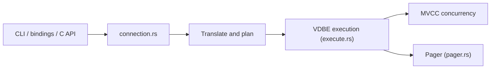

# tursodatabase/turso

> Embedded SQL database in Rust, compatible with SQLite, with an experimental Postgres frontend and an MCP mode.

## The problem
SQLite is reliable but hard to evolve (native async, concurrency, vector search).

## What it actually does
A rewrite of SQLite in Rust that compiles SQL to bytecode (VDBE) and executes it. Compatible at the dialect, file format and C API levels (COMPAT.md tracks the gaps). Bindings for Rust, JS, Python, Go, .NET, Java. The built-in MCP server (`tursodb --mcp`) exposes nine tools (list tables, queries, inserts…). Not yet at 1.0: the README advises independent backups.

## How it is wired


## Trying it
```bash
curl --proto '=https' --tlsv1.2 -LsSf https://github.com/tursodatabase/turso/releases/latest/download/turso_cli-installer.sh | sh
tursodb
claude mcp add my-database -- tursodb ./path/to/your/database.db --mcp
```

## Cost and gotchas
Free. Before 1.0: not 100% SQLite-compatible, some experimental features. 1,485 open issues.

## What it is not
Not libSQL (a fork, a separate project). The Postgres frontend is still experimental.

## Alternatives
- libSQL: a fork of SQLite, proven for longer.

## For you
The MCP mode gives an agent SQLite access in a few minutes; keep watching before 1.0 for any serious use.
