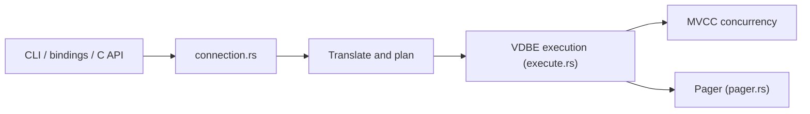

# tursodatabase/turso

> Base SQL embarquée en Rust compatible SQLite, avec frontend Postgres expérimental et mode MCP.

## Le problème
SQLite est fiable mais difficile à faire évoluer (async natif, concurrence, recherche vectorielle).

## Ce que ça fait vraiment
Réécriture de SQLite en Rust, qui compile le SQL en bytecode (VDBE) et l'exécute. Compatible au niveau dialecte, format de fichier et API C (COMPAT.md suit les écarts). Bindings Rust, JS, Python, Go, .NET, Java. Le serveur MCP intégré (`tursodb --mcp`) expose neuf outils (lister tables, requêtes, insertions…). Pas encore en 1.0 : le README conseille des sauvegardes indépendantes.

## Comment c'est branché


## Essayer
```bash
curl --proto '=https' --tlsv1.2 -LsSf https://github.com/tursodatabase/turso/releases/latest/download/turso_cli-installer.sh | sh
tursodb
claude mcp add my-database -- tursodb ./path/to/your/database.db --mcp
```

## Coût et pièges
Gratuit. Avant la 1.0 : pas 100 % compatible SQLite, certaines fonctions expérimentales. 1 485 issues ouvertes.

## Ce que ce n'est pas
Pas libSQL (fork, projet distinct). Le frontend Postgres est encore expérimental.

## Alternatives
- libSQL : fork de SQLite, éprouvé plus longtemps.

## Pour toi
Le mode MCP donne à un agent un accès SQLite en quelques minutes ; à surveiller avant 1.0 pour tout usage sérieux.

