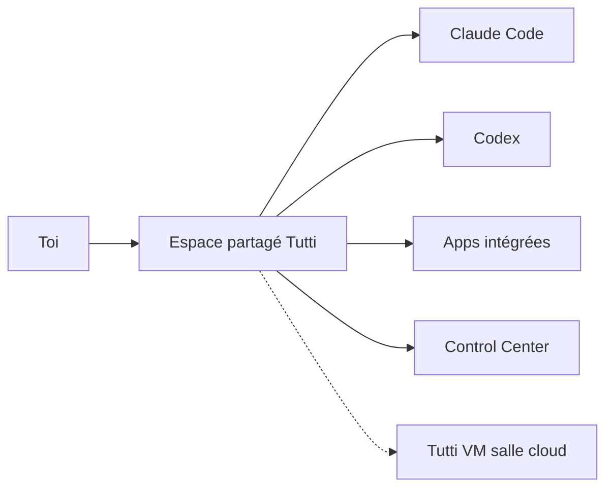

# tutti-os/tutti

> Shared workspace where Claude Code, Codex and Hermes exchange context, files and tasks, with a graphical interface.

## The problem
When several agents work together, you are the one copying context, docs and visuals from one to the other.

## What it actually does
Connects your existing agents (Claude Code, Codex, Hermes; OpenClaw in progress) to a common space. The "Big @" references conversations, files and tasks of one agent from another. An app center (image, UI design, docs, presentations) is usable by you and the agents. A Control Center lists pending approvals, and a tool breaks a goal down into tasks. The VM version (early access) adds shared rooms, multi-user and cloud.

## How it is wired
Simplified diagram based on the sheet, no diagram provided.

## Trying it
The README gives no command: it offers to download Tutti Local for macOS or Windows (x64) and refers to CONTRIBUTING.md for development.

## Cost and gotchas
Runs on your existing subscriptions. The Tutti agent is free during early access, with usage-based billing possibly coming later. Creating a VM room requires an invitation code. Last push in October 2026, with 190 open issues.

## What it is not
Not a replacement for your coding agent. The open-source version has no group chat, no work with other people, and no simultaneous editing: all of that is reserved for the VM version.

## Alternatives
No alternative named in the README.

## For you
Worth watching: the idea of shared context between agents is useful, but the collaborative features depend on a cloud offering in early access.
