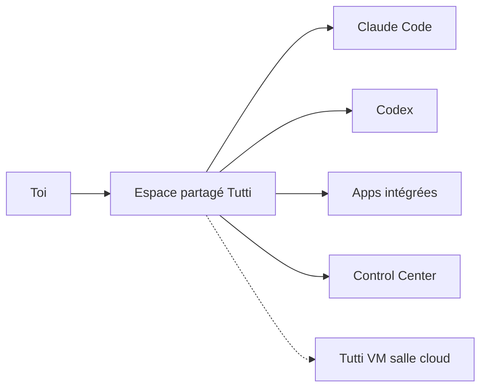

# tutti-os/tutti

> Espace de travail partagé où Claude Code, Codex et Hermes échangent contexte, fichiers et tâches, avec interface graphique.

## Le problème
Quand plusieurs agents travaillent ensemble, c'est toi qui recopies contexte, docs et visuels de l'un à l'autre.

## Ce que ça fait vraiment
Connecte tes agents existants (Claude Code, Codex, Hermes ; OpenClaw en cours) à un espace commun. Le « Big @ » référence conversations, fichiers et tâches d'un agent depuis un autre. Un centre d'apps (image, design UI, docs, présentations) est utilisable par toi et les agents. Un Control Center liste les approbations en attente, et un outil découpe un objectif en tâches. La version VM (accès anticipé) ajoute salles partagées, multi-utilisateurs et cloud.

## Comment c'est branché
Schéma simplifié d'après la fiche, sans diagramme fourni.

## Essayer
Le README ne donne pas de commande : il propose de télécharger Tutti Local pour macOS ou Windows (x64) et renvoie à CONTRIBUTING.md pour le développement.

## Coût et pièges
Tourne sur tes abonnements existants. L'agent Tutti est gratuit pendant l'accès anticipé, une facturation à l'usage pouvant venir ensuite. Créer une salle VM demande un code d'invitation. Dernier push en octobre 2026, avec 190 issues ouvertes.

## Ce que ce n'est pas
Pas un remplaçant de ton agent de code. La version open source n'a ni chat de groupe, ni travail avec d'autres personnes, ni édition simultanée : tout cela est réservé à la version VM.

## Alternatives
Aucune alternative nommée dans le README.

## Pour toi
À surveiller : l'idée de contexte partagé entre agents est utile, mais les fonctions collaboratives dépendent d'une offre cloud en accès anticipé.

