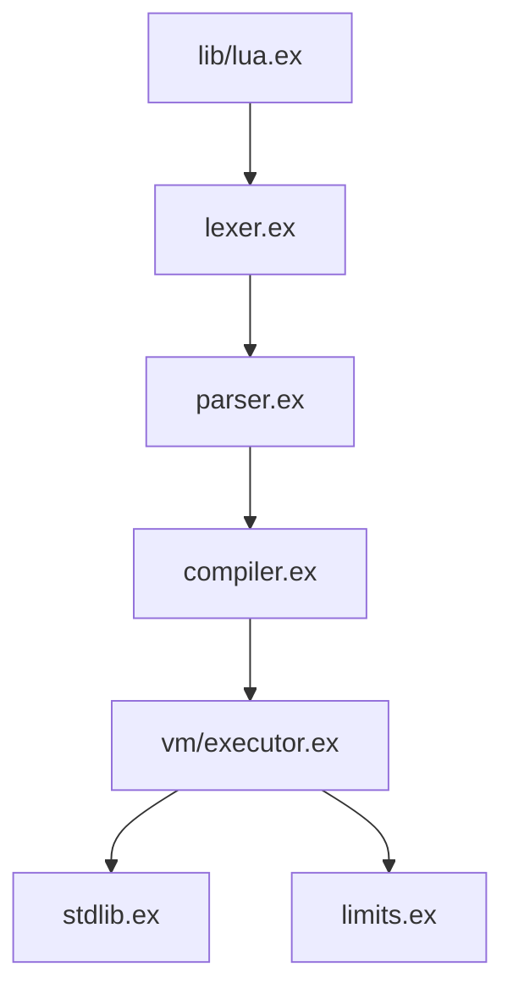

# tv-labs/lua

> Lua 5.3 virtual machine in pure Elixir for running untrusted scripts in a sandbox.

## The problem
Running code produced by users or AI agents without access to the host system.

## What it actually does
Lexer, parser, compiler and register-based VM written in Elixir, no NIFs. The sandbox blocks `os.execute`, `io`, `require`, `load`. Limits `max_call_depth` and `max_instructions`. Elixir functions are exposed via `deflua`. No coroutines.

## How it is wired


## Trying it
```bash
# mix.exs : {:lua, "~> 1.0.0"}
# iex> {[4], _lua} = Lua.eval!("return 2 + 2")
```

## Cost and gotchas
Free. Requires Elixir (outside the prerequisites list). By default there is no instruction limit: you need to set one.

## What it is not
Not a standalone Lua interpreter; coroutines and GC are absent. No guarantee of a global memory limit.

## Alternatives
Luerl: the earlier project that this one draws on, cited in the README.

## For you
Watch: relevant if you give an AI agent a sandbox on the Elixir side; otherwise outside your usual stack.
