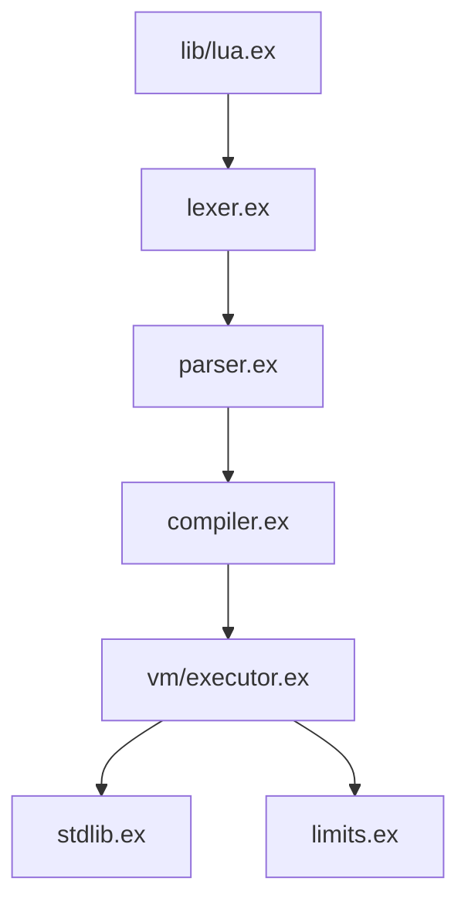

# tv-labs/lua

> Machine virtuelle Lua 5.3 en pur Elixir pour exécuter des scripts non fiables en bac à sable.

## Le problème
Exécuter du code produit par des utilisateurs ou des agents IA sans accès au système hôte.

## Ce que ça fait vraiment
Lexer, parser, compilateur et VM à registres écrits en Elixir, sans NIF. Le bac à sable bloque `os.execute`, `io`, `require`, `load`. Limites `max_call_depth` et `max_instructions`. Des fonctions Elixir sont exposées via `deflua`. Pas de coroutines.

## Comment c'est branché


## Essayer
```bash
# mix.exs : {:lua, "~> 1.0.0"}
# iex> {[4], _lua} = Lua.eval!("return 2 + 2")
```

## Coût et pièges
Gratuit. Il faut Elixir (hors liste des prérequis). Par défaut aucune limite d'instructions : à régler.

## Ce que ce n'est pas
Pas un interpréteur Lua autonome ; coroutines et GC absents. Pas une garantie de limite mémoire globale.

## Alternatives
Luerl : projet précédent dont celui-ci s'inspire, cité dans le README.

## Pour toi
À surveiller : pertinent si tu donnes un bac à sable à un agent IA côté Elixir ; sinon hors de ta pile habituelle.

