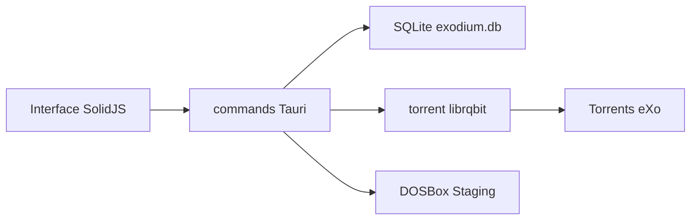

# tvollstaedt/exodium

> Cross-platform launcher for the eXoDOS retro game collections, for DOS gaming fans.

## The problem
eXoDOS only offers a LaunchBox launcher for Windows and forces you to download about 500 GB of torrent to browse the catalog.

## What it actually does
A Tauri v2 application (SolidJS, Rust, SQLite) lets you browse the catalog and download a game on demand via torrent (librqbit). It launches it in DOSBox Staging, ScummVM or other emulators fetched as needed. It handles favorites, playlists, a kids mode with a PIN code, manuals and preview videos.

## How it is wired


## Trying it
```bash
xattr -cr /Applications/Exodium.app

pnpm install
pnpm run init-dev
pnpm tauri dev
```

## Cost and gotchas
Free, but the Windows and macOS installers are unsigned: SmartScreen and Gatekeeper warnings. Games come through torrent. The development initialization downloads 2 to 5 GB, and up to 23 GB with the German language pack.

## What it is not
Not a game host: it distributes no files. It does not replace the eXoDOS collection itself.

## Alternatives
LaunchBox: the original eXoDOS Windows launcher, which this app replaces.

## For you
Ignore: a retro game launcher, unrelated to data, AI or MLOps.
