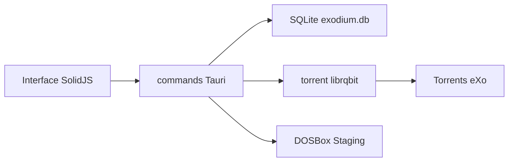

# tvollstaedt/exodium

> Lanceur multiplateforme pour les collections de jeux rétro eXoDOS, pour amateurs de jeux DOS.

## Le problème
eXoDOS n'offre qu'un lanceur LaunchBox pour Windows et oblige à télécharger environ 500 Go de torrent pour parcourir le catalogue.

## Ce que ça fait vraiment
Une application Tauri v2 (SolidJS, Rust, SQLite) permet de parcourir le catalogue et de télécharger un jeu à la demande via torrent (librqbit). Elle le lance dans DOSBox Staging, ScummVM ou d'autres émulateurs récupérés au besoin. Elle gère favoris, playlists, mode enfants avec code PIN, manuels et vidéos d'aperçu.

## Comment c'est branché


## Essayer
```bash
xattr -cr /Applications/Exodium.app

pnpm install
pnpm run init-dev
pnpm tauri dev
```

## Coût et pièges
Gratuit, mais les installateurs Windows et macOS ne sont pas signés : avertissements SmartScreen et Gatekeeper. Les jeux passent par torrent. L'initialisation de développement télécharge de 2 à 5 Go, et jusqu'à 23 Go avec le pack de langue allemand.

## Ce que ce n'est pas
Pas un hébergeur de jeux : il ne distribue aucun fichier. Il ne remplace pas la collection eXoDOS elle-même.

## Alternatives
LaunchBox : le lanceur Windows d'origine d'eXoDOS, que cette app remplace.

## Pour toi
À ignorer : un lanceur de jeux rétro, sans rapport avec la data, l'IA ou le MLOps.

