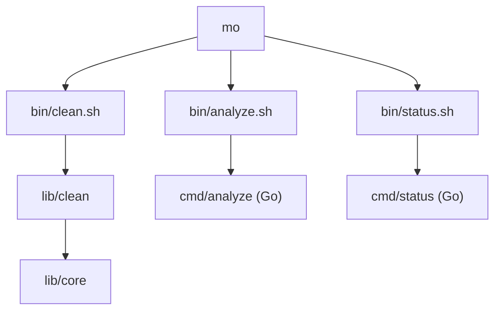

# tw93/Mole

> A command-line interface (CLI) for macOS that cleans the disk, uninstalls applications, optimizes the system, and monitors its performance.

## The problem
Cleaning caches, application remnants, and build artifacts on a Mac requires multiple separate applications.

## What it actually does
The `mo` command combines the following: `clean` (caches, logs), `uninstall` (apps and remnants), `optimize`, `analyze` (disk explorer), `status` (CPU, memory, and network dashboard), `purge` (node_modules, target, dist), `install`, and `slim`. It consists of shell scripts and Go subcommands (`analyze`, `status`). Each uninstall operation can be previewed with the `--dry-run` option.

## How it is wired


## Trying it
```bash
brew install mole
mo clean --dry-run
mo analyze
mo status
```

## Cost and gotchas
Free. Requires macOS 12+. Some commands (`clean`, `purge`, `installer`) permanently delete: always use the `--dry-run` option first.

## What it is not
This software is not compatible with Linux or WSL (the Windows version is a separate product), nor with the native "Mole for Mac" application, which is sold separately.

## Alternatives
The README mentions CleanMyMac, AppCleaner, DaisyDisk, and iStat Menus as tools that it utilizes in a similar way.

## For you
Please note: This only works on Mac, and your operating system is Linux.
