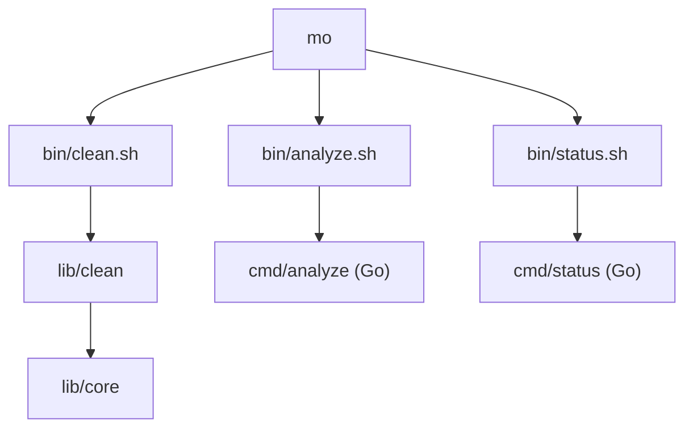

# tw93/Mole

> CLI pour macOS qui nettoie le disque, désinstalle des apps, optimise et surveille le système.

## Le problème
Nettoyer caches, restes d'applications et artefacts de build sur un Mac demande plusieurs applications séparées.

## Ce que ça fait vraiment
La commande `mo` regroupe : `clean` (caches, logs), `uninstall` (apps et restes), `optimize`, `analyze` (explorateur de disque), `status` (tableau de bord CPU, mémoire, réseau), `purge` (node_modules, target, dist), `installer`, `slim`. Mélange de scripts shell et de sous-commandes Go (`analyze`, `status`). Chaque suppression se prévisualise avec `--dry-run`.

## Comment c'est branché


## Essayer
```bash
brew install mole
mo clean --dry-run
mo analyze
mo status
```

## Coût et pièges
Gratuit. Requiert macOS 12+. Certaines commandes (`clean`, `purge`, `installer`) suppriment définitivement : toujours passer par `--dry-run`.

## Ce que ce n'est pas
Ce n'est pas utilisable sous Linux ou WSL (la version Windows est une branche séparée), ni l'application native « Mole for Mac », vendue à part.

## Alternatives
Le README cite CleanMyMac, AppCleaner, DaisyDisk et iStat Menus comme outils dont il reprend les usages.

## Pour toi
À ignorer : il ne sert que sur Mac, et ton poste est Linux.

